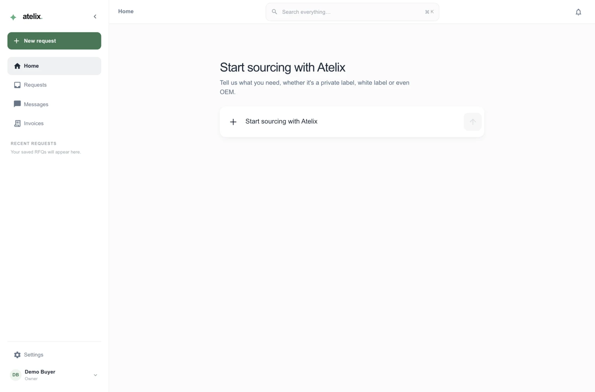
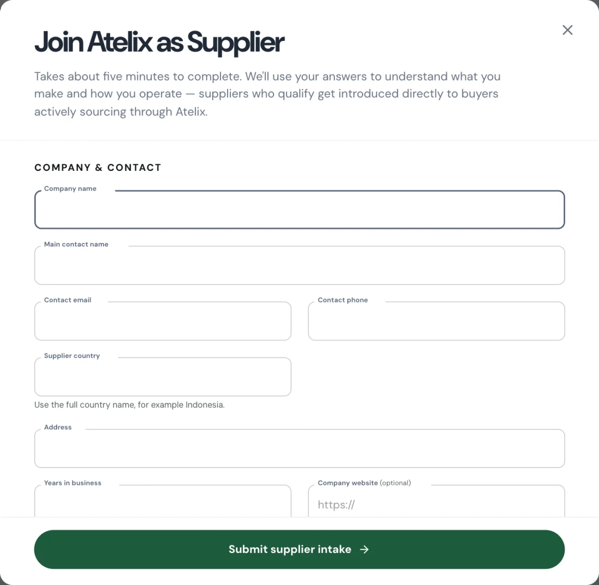

<h1 align="center">Atelix Sourcing</h1>

<p align="center">Source apparel, fabrics, and trims from brief to production.</p>

<p align="center">
  <a href="#what-you-can-do">Features</a> ·
  <a href="#scope-and-limits">Scope and limits</a> ·
  <a href="#run-locally">Local setup</a> ·
  <a href="#technical-documentation">Technical docs</a>
</p>


Atelix is a B2B fashion sourcing workspace for brands sourcing apparel, fabrics, trims, labels, accessories, or OEM and cut-and-sew production. Buyers describe what they need, and Atelix Operations reviews the brief, matches vetted suppliers, and coordinates the commercial and production handoff.

## What you can do

| Step | What happens |
| --- | --- |
| **1. Draft a request** | Start with a written brief and attach references such as an image or tech pack. Edit the resulting request for quotation (RFQ) before submitting it to Atelix. |
| **2. Work with Atelix Operations** | Follow your request and message the sourcing team in the same case. Operations reviews requirements, evaluates eligible suppliers, and handles outreach and quote review. |
| **3. Review quotes and pay an invoice** | Open published quotes from the request. When Atelix issues a payable invoice, review it and use Stripe-hosted checkout where available. |
| **4. Follow production and delivery** | View linked orders and updates that Operations has published. Quality and shipment milestones depend on the evidence reviewed for that request. |

### Buyer workspace

**Home** starts a brief. **Requests** houses the editable RFQ and its timeline, files, quotes, and orders. **Messages** keeps buyer and Operations conversations alongside their requests. **Invoices** shows bills and payment history. Buyer access starts with an application and team approval.



### Supplier intake and Intools

Suppliers use **Join Us** to submit company details, manufacturing capabilities, and supporting information for private review. Atelix staff use **Intools** to review access and supplier submissions, handle requests and quotes, publish invoices, and record production and quality updates.



## Scope and limits

- **Sourcing scope.** The product supports broker-led fashion sourcing. Public catalogues, supplier directories, seller storefronts, carts, wishlists, and direct marketplace checkout are outside the current scope.
- **AI and review.** AI can help structure a brief and summarize supplied evidence where configured. Operations reviews matches and controls outreach and quote release. Supplier capabilities, pricing, minimum order quantities, and certifications depend on reviewed records.
- **Commercial and fulfillment authority.** The server determines checkout eligibility and amounts. Verified Stripe webhooks confirm Stripe settlement. Production updates and buyer-visible quality evidence depend on feature settings and staff review. Automated final QC approval and shipment release are outside the current scope.
- **Access.** Requests, files, conversations, invoices, and supplier records are permissioned. The implementation includes authenticated app interfaces. A public supplier or transaction API and a public MCP server are unavailable.

## Run locally

The repo contains a React and Vite frontend, an Express development API, and Supabase migrations and Edge Functions.

### Launch the UI

Use Node.js 22.12+ on the 22.x line or Node.js 24 LTS, with npm.

```bash
git clone https://github.com/jun850/ai-sourcing-agents.git marketplace
cd marketplace
npm ci
npm run dev
```

Open [localhost:3000](http://localhost:3000). Vite proxies local API requests to Express on port 3001. The landing page and public UI can be previewed with this setup. Sign-in and saved workflows require Supabase.

### Enable local accounts and data

With Docker running and the Supabase CLI installed, stop the dev server if it is already running. The setup script expects a checkout named `marketplace`. The standard local Supabase ports must be free.

```bash
npm run supabase:local:setup
npm run dev
```

The setup script starts local Supabase, writes ignored local environment files, and creates the local administrator. It prints the sign-in details for `/intools` and the URLs for Studio and Mailpit. Use [`.env.local.example`](.env.local.example) for the app settings.

For workflows that invoke Edge Functions, run the following in a separate terminal.

```bash
npm run supabase:local:functions
```

The generated local configuration has live provider integrations disabled. Stripe checkout, model-backed drafting and reference extraction, and external email delivery depend on the relevant test-provider settings. See the [Edge Function environment example](supabase/functions/.env.local.example) for server-side configuration. Keep provider secrets out of Vite variables and Git.

If Colima reports a Docker socket mount error for `supabase_vector_marketplace`, disable analytics in your local copy of [`supabase/config.toml`](supabase/config.toml) with `[analytics]` and `enabled = false`, then rerun setup.

### Build and check

```bash
npm run lint
npm run build
npm run qa:endpoint-contracts
```

## Technical documentation

- [Product contract](PRODUCT.md) for workflows, roles, and authority boundaries
- [Design rules](DESIGN.md) for the buyer workspace and Intools
- [Engineering docs](docs/README.md) for architecture, data flows, and the production and visual QC feature wave
- [Repository instructions](AGENTS.md) for contribution and verification
