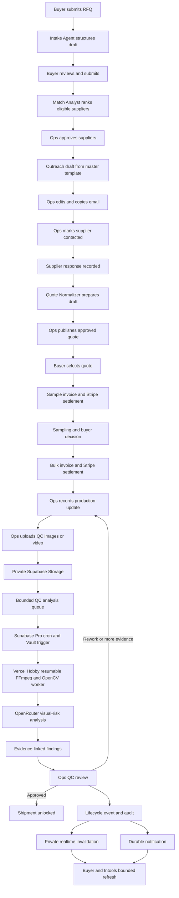

# Atelix AI-Native Human-Loop Platform and Visual QC Master Plan

Status: Decision-complete implementation specification
Date: 2026-09-05 (infrastructure revision)
Audience: Product, Operations, Engineering, Security, and QA
Owner: Head of Engineering

## 1. Executive summary

Atelix should become an AI-native sourcing control plane without becoming an autonomous marketplace. The buyer describes what they need; agents structure the work, retrieve real records, prepare supplier outreach, normalize commercial responses, analyze production evidence, and keep the operational timeline current. Atelix Operations remains accountable for every consequential action.

The target journey is:

> Buyer brief -> reviewed RFQ -> eligible supplier recommendations -> Ops-approved outreach -> supplier-confirmed terms -> Ops-approved quotes -> buyer selection -> sample and payment gates -> production evidence -> AI visual-risk triage -> Ops QC approval -> shipment and delivery.

This plan extends the existing buyer surfaces—Home, Requests, Messages, and Invoices—and the existing Intools operational shell. It does not create a public supplier directory, catalogue, cart, seller storefront, standalone Products workspace, or separate AI control center.

The primary product promise is simple:

1. The buyer tells Atelix what they need.
2. AI prepares the operational work.
3. Humans authorize supplier, commercial, quality, and logistics decisions.
4. Buyer and administrator monitor the same authoritative progress in real time.

## 2. Production vision

### 2.1 Desired operating model

Atelix coordinates a sourcing case from first brief through delivery. Each case has:

- One durable RFQ and evidence set.
- A private set of eligible supplier recommendations.
- Explicit supplier-release decisions by Ops.
- Traceable outreach drafts and contact events.
- Supplier-confirmed commercial evidence.
- Buyer-visible quotes approved by Ops.
- Sample, bulk, payment, QC, shipment, and delivery gates.
- A realtime activity stream derived from committed server events.
- A clear current owner and next action.

AI should reduce manual synthesis, not erase accountability. Every agent output is one of:

- A draft.
- A recommendation.
- A normalized representation of supplied facts.
- A risk observation.
- A missing-evidence request.
- A summary of already committed records.

Agent output never becomes supplier, commercial, payment, production, QC, shipment, or delivery truth merely because a model generated it.

### 2.2 Truth and authority layers

All product and technical work must preserve these layers:

| Layer | Meaning | Examples | May AI create it? |
|---|---|---|---|
| Buyer-stated | Submitted by the buyer | Product, quantity, target budget, material, requested timeline | AI may extract and structure; buyer text remains the source |
| AI-extracted | Model interpretation tied to evidence | Visible requirement, suspected defect, missing view | Yes, as a non-authoritative observation |
| Supplier-confirmed | Received from a supplier and recorded by Ops | MOQ, price, lead time, availability, quote validity | No; AI may normalize only |
| Ops-verified | Reviewed and accepted by an accountable operator | Supplier release, quote publication, QC review, mitigation | No |
| Server-authoritative | Committed by guarded backend workflow | Roles, state, invoice total, payment settlement, shipment eligibility | No |

### 2.3 Locked decisions

- Factory updates are Ops-mediated in the first release.
- A single accountable Ops user can approve a supplier for outreach, publish a quote, and publish a QC review. Every action is immutable and attributable.
- Buyers see every Ops-approved quote, up to the existing maximum of three. Internal recommendations and rejected suppliers remain private.
- AI visual QC is triage-only. It can assign risk, identify missing evidence, and cite image/frame evidence. It cannot publish a pass or fail.
- In-app updates are realtime for committed events. Email is reserved for required actions, exceptions, and missed deadlines.
- Supabase records and guarded RPCs are authoritative.
- Stripe webhooks are the only payment-settlement authority.
- QC originals remain private. Buyers see only media explicitly approved for buyer visibility by Ops.

### 2.4 Requirements

#### Functional requirements

- Preserve the supported buyer path: prompt or reference -> RFQ -> human review -> vetted matching -> approved quote -> invoice and Stripe payment -> quality and logistics coordination.
- Require an attributable Ops decision before a supplier may be contacted, a quote may be published, a QC result may become authoritative, or shipment may be unlocked.
- Let Intools administrators create, version, preview, activate, and audit an English supplier-outreach template from Master settings.
- Let an Ops user open an RFQ-scoped outreach modal, review the resolved email subject and body, edit the draft, copy either field, and explicitly record external contact.
- Support documented placeholders, including `[.product]` and `[.budget]`, without inventing missing buyer or supplier values.
- Store supplier-confirmed commercial terms separately from AI-normalized drafts and Ops-published quotes.
- Show buyer and Ops users a shared, server-authoritative production timeline while retaining private operational notes and unreleased evidence.
- Accept private QC images and videos, validate their provenance, derive analysis media, and produce evidence-linked visible-risk findings across the supported product categories.
- Require human QC review with approve, rework, reinspect, reject-evidence, and escalate outcomes.
- Notify the correct audience after the underlying transaction commits, with in-app realtime delivery and bounded email escalation.
- Retain immutable audit events for approvals, template revisions, outreach copies, supplier responses, quotes, production changes, QC analysis, QC review, notifications, shipment, and delivery.

#### Non-functional requirements

- Enforce authentication, role checks, RFQ ownership, private Storage access, row-level security, and guarded server mutations at every boundary.
- Keep AI outputs schema-valid, evidence-linked, versioned, reproducible, and explicitly non-authoritative until reviewed where required.
- Avoid unbounded PostgREST work, per-record N+1 calls, retry storms, and tight polling; use aggregate reads, bulk RPCs, bounded queues, idempotency keys, capped concurrency, and exponential backoff.
- Keep migrations additive and immutable after application.
- Make all long-running media work resumable and safe to retry without duplicating findings, events, or notifications.
- Meet WCAG 2.2 AA interaction requirements for keyboard use, focus, status announcements, reduced motion, contrast, and responsive layouts.
- Preserve the dashboard prompt and authenticated composer visual contract.
- Separate source, build, local database, linked database, authenticated-browser, deployed-runtime, Storage, model-provider, email-provider, and Stripe verification evidence.
- Provide feature-flagged rollout and rollback that never requires deleting authoritative records.
- Record model version, policy version, checklist version, prompt version, evidence hashes, latency, cost, and reviewer outcome for evaluation and audit.

## 3. Personas and decision rights

### 3.1 Buyer

The buyer can:

- Submit and revise an RFQ while it is a draft.
- Approve and submit the RFQ for Atelix review.
- Read committed progress and published evidence for their own cases.
- Compare all published quotes and select one.
- Initiate Stripe Checkout for an eligible invoice.
- Approve or decline a ready sample.
- Respond to Ops through the RFQ-scoped Messages workspace.

The buyer cannot:

- See private routing scores, rejected suppliers, internal rationale, or unreviewed findings.
- Contact suppliers through the platform.
- Set price, invoice, payment, production, QC, shipment, or delivery state.

### 3.2 Atelix Operations

An authenticated administrator can:

- Review the submitted RFQ and evidence.
- Approve or reject each recommended supplier.
- Prepare and edit supplier-outreach drafts.
- Record that an approved supplier was contacted externally.
- Record supplier-confirmed responses and supporting evidence.
- Review and publish buyer-visible quotes.
- Upload or record factory production evidence.
- Review AI visual-risk findings.
- Publish the authoritative QC decision.
- Advance guarded fulfillment stages when their prerequisites are satisfied.

### 3.3 Runtime agents

Agents can read only the minimum data needed for their job and return strictly typed outputs.

| Agent | Input | Output | Forbidden authority |
|---|---|---|---|
| Intake Agent | Buyer prompt, references, current RFQ draft | Supported field patch, questions, evidence links | Cannot submit RFQ or invent requirements |
| Match Analyst | Submitted RFQ, real eligible factories, policy | Ranked existing factory IDs with grounded rationale | Cannot make a supplier eligible or approve outreach |
| Outreach Draft Agent | Active template, resolved allowlisted fields | Editable English subject and body | Cannot send email or add supplier/commercial facts |
| Quote Normalizer | Supplier-confirmed source terms | Comparable structured draft | Cannot determine or publish authoritative price |
| Production Summarizer | Ops-entered update and evidence metadata | Concise draft summary and missing-field flags | Cannot advance production state |
| QC Vision Triage Agent | Approved specification, checklist, derived images | Evidence-linked visible-risk findings | Cannot pass QC or unlock shipment |
| Risk Monitor | Authoritative dates, current state, unresolved issues | SLA/exception flags | Cannot change deadlines or state |
| Notification Composer | Committed event payload | Grounded buyer/admin copy | Cannot emit an event on its own |

## 4. End-to-end process

### 4.1 Simple buyer-facing process

1. Buyer describes a product or uploads a reference.
2. AI structures an RFQ without inventing missing facts.
3. Buyer reviews and submits the RFQ.
4. Atelix reviews eligible suppliers before anyone is contacted.
5. Atelix contacts approved suppliers using an Ops-reviewed email draft.
6. Supplier responses are normalized into comparable quote drafts.
7. Atelix publishes approved quotes.
8. Buyer chooses a quote and pays the sampling invoice.
9. Sampling progresses and the buyer approves or declines the result.
10. The paid bulk phase begins.
11. Factory images and videos are analyzed for visible risk.
12. Atelix publishes verified progress, QC, shipment, and delivery updates.

### 4.2 Detailed gate table

| Gate | Starting state | AI work | Human action | Server guard | Resulting event |
|---|---|---|---|---|---|
| RFQ draft | New request | Extract supported fields and identify missing details | Buyer confirms submission | Buyer owns case; revision matches; supported fields only | `rfq_submitted` |
| Supplier routing | `needs_research` | Rank real eligible suppliers | Ops approves/rejects each candidate | Recheck verified, broker-approved, active, compatible supplier | `supplier_match_approved` or `supplier_match_rejected` |
| Outreach draft | Approved match | Render template; optionally improve wording | Ops edits/copies draft | Match still approved; RFQ submitted; placeholders valid | `outreach_draft_copied` |
| Supplier contacted | Copied or saved draft | None | Ops explicitly marks contacted | Approved match and current draft revision | `supplier_contacted` |
| Supplier response | Awaiting supplier | Extract terms from recorded evidence for review | Ops confirms source terms | Supplier request belongs to RFQ and match | `supplier_response_recorded` |
| Quote publication | Quote draft | Normalize comparable terms | Ops publishes quote | Approved match; positive server-validated values; quote cap | `quote_published` |
| Quote selection | Published quotes | Compare and summarize | Buyer selects one | Buyer owns case; quote still published; no prior selection | `proposal_selected` |
| Sample payment | Sample invoice sent | Explain recorded state | Buyer initiates Checkout | Server-computed invoice; verified webhook settles | `invoice_paid:sample` |
| Sample readiness | Paid sampling | Summarize Ops update | Ops publishes sample ready | Lifecycle is `sample_in_progress` | `sample_ready` |
| Sample decision | Sample ready | None | Buyer approves/declines | Buyer owns case; one pending decision | `sample_approved` or `sample_declined` |
| Bulk payment | Approved sample | Explain recorded state | Buyer initiates Checkout | Server-computed invoice; verified webhook settles | `invoice_paid:bulk` |
| Production update | Paid bulk | Structure update and identify missing evidence | Ops publishes update | Valid state, expected revision, evidence ownership | `production_update_published` |
| QC analysis | Quality-inspection evidence received | Detect visible risks and missing views | None yet | Immutable assets; valid checklist; idempotent run | `qc_analysis_ready` |
| QC review | Analysis ready | Present risks and evidence | Ops approves, requests rework/reinspection, or rejects evidence | Reviewer is admin; analysis/evidence revision matches | `qc_review_published` |
| Shipment | Approved QC | Summarize shipment evidence | Ops advances shipment | Latest QC review is approved | `stage_changed:shipped` |
| Delivery | Shipped | Summarize delivery evidence | Ops confirms delivery | Ordered transition; evidence retained | `stage_changed:delivered` |

## 5. Supplier-outreach drafting

### 5.1 Intools Master settings

Add the explicitly requested `/intools/settings` route as the tenth Intools navigation section, titled **Master settings**. This is allowed because it is an explicitly requested operational surface.

The first settings group is **Supplier outreach email** and contains:

- English subject template.
- English body template.
- Supported-placeholder reference.
- Preview with clearly labeled non-production sample values.
- Save as a new version.
- Activate version.
- Restore the last active version.
- Creator, activator, and timestamps.
- Read-only template audit history.

Do not store the template in `platform_settings`. That table is publicly readable and provides neither structured validation nor immutable version history. Use a new private, admin-only, versioned contract.

### 5.2 Request-drawer interaction

Within each approved supplier match in the existing Request drawer, show one CTA:

**Prepare supplier email**

The button remains disabled for suggested, rejected, or otherwise ineligible matches. It opens a centered modal with:

- Supplier name and RFQ number.
- Editable subject input.
- Editable body textarea.
- `Copy subject`, `Copy body`, and `Copy all` actions.
- `Reset from latest master template` action.
- `Mark supplier as contacted` as the single consequential action.
- Saved-draft status, template version, last editor, and revision.
- Loading, validation, stale-revision, save-error, copy-success, and permission-denied states.

Copying content is not sending email. The platform must not show `sent` or advance supplier-outreach state merely because clipboard access succeeded. Ops explicitly records external contact after sending the email outside Atelix.

### 5.3 Placeholder contract

Allowed placeholders are:

```text
[.case_no]
[.product]
[.quantity]
[.material]
[.certifications]
[.colors]
[.sizes]
[.budget]
[.timeline]
[.supplier_name]
```

The settings note and modal tooltip must contain this instruction:

> Use placeholders such as `[.product]` and `[.budget]`. Values are inserted from the submitted RFQ and approved supplier record. Missing RFQ values appear as `Not provided by buyer`.

Unknown placeholders block activation. Resolution is deterministic and server-side. The renderer uses the submitted RFQ snapshot and current approved supplier record; it never reads buyer revenue, private routing rationale, or other profile context.

Default subject:

```text
RFQ [.case_no] — [.product]
```

Default body:

```text
Hello [.supplier_name],

Atelix is reviewing production partners for the following sourcing request.

Product: [.product]
Quantity: [.quantity]
Material: [.material]
Colors: [.colors]
Sizes: [.sizes]
Certifications requested: [.certifications]
Buyer-stated budget: [.budget]
Required timeline: [.timeline]

Please confirm whether this request fits your capabilities and provide your current MOQ, unit price, lead time, sample terms, production availability, certification evidence, and quote validity.

Regards,
Atelix Operations
```

### 5.4 Outreach data contracts

#### `rfq_outreach_template_versions`

| Field | Contract |
|---|---|
| `id` | UUID primary key |
| `locale` | `en` in v1 |
| `version` | Monotonic integer |
| `subject_template` | 1–240 characters |
| `body_template` | 1–12,000 characters |
| `status` | `draft`, `active`, or `retired` |
| `created_by`, `activated_by` | Admin profile IDs |
| timestamps | Creation and activation evidence |

Activated versions are immutable. Editing creates a new version. Only one English version may be active.

#### `rfq_supplier_outreach_drafts`

| Field | Contract |
|---|---|
| `rfq_case_id` | Submitted RFQ |
| `match_id` | Approved supplier match |
| `template_version_id` | Exact source template |
| `subject`, `body` | Editable rendered draft |
| `resolved_fields` | Snapshot of allowlisted substitutions |
| `status` | `draft`, `copied`, `contacted`, or `superseded` |
| `revision` | Optimistic concurrency integer |
| `created_by`, `updated_by` | Admin profile IDs |

Only one current non-superseded draft exists for a case and match.

#### `rfq_supplier_outreach_events`

Append-only events for creation, edit, reset, copy, contact, and supersession. A copy event records which part was copied but does not claim delivery.

#### `rfq_outreach_generation_runs`

Stores model/preset, prompt hash, template version, token/cost/latency metadata, output status, and failure reason. Model output is never required for deterministic placeholder rendering.

## 6. Quote approval

All buyer-visible quotes remain tied to approved matches and supplier-confirmed terms.

Replace the current three-call quote path—upsert, set total, publish—with one atomic RPC. The current path can persist a partial draft if a later request fails and causes unnecessary PostgREST traffic.

The atomic publication operation must:

1. Lock the quote and RFQ.
2. Revalidate match approval and supplier eligibility.
3. Validate positive unit price, MOQ, lead time, and total.
4. Enforce USD in v1 and the maximum of three visible quotes.
5. Store supplier-evidence references and the reviewed commercial snapshot.
6. Mark the approving operator and time.
7. Publish the quote.
8. Append audit/lifecycle events.
9. Emit the buyer notification within the same transaction.

AI can normalize source terms into a draft but cannot calculate undocumented landed cost, fees, freight, tax, duty, or margin.

## 7. Production monitoring

### 7.1 Existing surfaces

Do not add a buyer navigation section. Extend the owning RFQ's Timeline and Orders/Production content with:

- Current phase and stage.
- Accountable owner.
- Latest Ops-verified update.
- Next expected update time.
- Evidence count.
- Open exception and mitigation.
- Required buyer action.
- Published QC review and selected evidence.

The Request row and Intools queue use the existing status, owner, due, count, and filter patterns. The Request drawer contains operational controls.

### 7.2 Production update contract

Every buyer-visible production update requires:

- Lifecycle phase and stage.
- Ops-verified note.
- Source and received-at time.
- Relevant evidence when the stage requires it.
- Next expected update time.
- Exception severity, when applicable.
- Mitigation or required follow-up for an exception.
- Publishing operator and time.

Draft updates remain private. Corrections create a new version and retain the prior published record.

### 7.3 Production states

Keep the existing top-level lifecycle states. Add structured substate beneath `quality_inspection` rather than rewriting applied lifecycle history:

```text
awaiting_evidence
uploading
analysis_queued
analyzing
review_required
approved
rework_required
reinspection_required
insufficient_evidence
analysis_failed
```

Only a current Ops-published `approved` QC review allows the guarded transition to `shipped`.

## 8. Visual QC scope and limitations

### 8.1 Supported first-release categories

Visual QC covers all requested fashion and beauty categories, using separate versioned checklists:

- Finished apparel and cut-and-sew goods.
- Fabrics and materials.
- Trims, buttons, labels, closures, and hardware.
- Fashion accessories.
- Skincare packaging and visible product condition.
- Beauty packaging, color, texture, shape, fill appearance, and visible condition.

### 8.2 Capture protocols

#### Apparel and finished goods

- Front, back, sides, and interior.
- Seams, stitching, hems, joins, closures, and hardware.
- Labels, branding, print, embroidery, and placement.
- Measurements with a readable scale.
- Surface finish, stains, holes, scratches, deformation, and damage.
- Repeated-unit view for visible consistency.
- Packing and carton markings.

#### Fabrics and materials

- Full-width or full-piece view.
- Roll or lot identity when provided.
- Face, reverse, and selvedge.
- Weave/knit and surface close-ups.
- Defect close-up with scale and surrounding context.
- Shade comparison under controlled lighting with a reference target.
- Packing condition.

#### Trims, buttons, labels, closures, and hardware

- Front, back, and side.
- Dimensions with readable scale.
- Finish, coating, color, edges, holes, teeth, puller, or fastening surface.
- Branding and artwork alignment.
- Attachment or operation demonstration where applicable.
- Repeated batch view for visible consistency.
- Packing and damage.

#### Fashion accessories

- All exterior sides and interior.
- Construction, joins, lining, straps, and hardware.
- Dimensions and silhouette.
- Branding, print, finish, and function.
- Packing and damage.

#### Skincare and beauty packaging

- Every panel.
- Label and artwork alignment.
- Batch/lot code when supplied.
- Seal, cap, closure, pump, or applicator.
- Fill appearance and level.
- Leakage, dents, scratches, print defects, deformation, and packing.

#### Visible skincare and beauty substance

- Controlled-light color view.
- Transparent-container view where possible.
- Texture spread or movement demonstration.
- Homogeneity, separation, sediment, bubbles, foreign visible matter, fill level, and shape.
- Every output is labeled `Visual observation only`.

### 8.3 What computer vision cannot approve

The system must never claim visual proof of:

- Chemical composition or ingredient identity.
- Microbiological safety, stability, or contamination not visibly observable.
- Fiber composition or material authenticity.
- Certification or regulatory compliance.
- Exact viscosity or other laboratory measurements.
- Durability, strength, colorfastness, waterproofing, or long-term function.
- Exact dimensions without a clearly readable scale.
- Exact color without controlled light, camera calibration, and a known reference.
- Complete order quantity from a partial view.
- Hidden construction or defects not captured by the evidence.

These require documents, instruments, laboratory testing, inspection protocols, or human verification outside the vision model.

## 9. Visual-risk taxonomy

The QC Vision Triage Agent returns findings only under this allowlist:

```text
evidence_quality
reference_mismatch
construction_or_workmanship
surface_damage
contamination_or_foreign_matter
color_or_finish_variation
measurement_evidence
label_or_packaging
seal_or_leakage
quantity_or_coverage
process_or_safety_observation
unknown
```

Each finding contains:

```json
{
  "category": "construction_or_workmanship",
  "severity": "medium",
  "confidence": 0.82,
  "asset_id": "uuid",
  "frame_id": "frame-0042",
  "timestamp_ms": 42000,
  "contact_sheet_cell": 6,
  "bounding_box": { "x": 0.31, "y": 0.42, "width": 0.18, "height": 0.12 },
  "observation": "Visible seam waviness along the lower edge.",
  "requirement_reference": "checklist:apparel:seam-finish",
  "why_it_matters": "May indicate inconsistent stitch tension or handling.",
  "uncertainty": "Thread tension cannot be confirmed from the image alone.",
  "recommended_follow_up": "Request a close-up from the front and reverse under neutral lighting."
}
```

Severity values are `low`, `medium`, `high`, or `unknown`. Risk level controls review priority only.

Forbidden output fields include `pass`, `fail`, `approved`, `shipment_ready`, inferred composition, inferred certification, or a claim that the complete order is conforming.

## 10. Human QC decisions

Ops may publish one of:

- `approved`
- `rework_required`
- `reinspection_required`
- `insufficient_evidence`

The review records:

- Exact analysis run and checklist version.
- Exact asset set reviewed.
- Accepted, dismissed, and amended findings.
- Ops decision and rationale.
- Buyer-visible summary.
- Buyer-visible asset IDs.
- Reviewer and timestamp.
- Expected next update when the decision is not approved.

An AI analysis failure, low risk score, or absence of findings never implies approval.

## 11. QC engine

### 11.1 Selected architecture

The selected first-release stack is:

- Supabase Pro Postgres for authoritative inspection, job, finding, review, lifecycle, and audit data.
- A new private Supabase Storage bucket for immutable QC evidence.
- Supabase TUS resumable upload for large videos.
- Supabase Vault, `pg_cron`, and `pg_net` for the authenticated worker schedule.
- A separate Vercel Hobby project for stateless, resumable CPU media processing from an OCI container.
- FFprobe and FFmpeg for validation, decoding, frame extraction, timestamps, and contact sheets.
- OpenCV for deterministic evidence-quality checks and frame selection.
- OpenRouter multimodal image requests for evidence-linked visual-risk analysis.
- The existing notification ledger and private Supabase Broadcast pattern for committed-event invalidation.

Supabase recommends resumable upload for files above 6 MB and unstable networks, using the direct Storage hostname for best performance: <https://supabase.com/docs/guides/storage/uploads/resumable-uploads>.

Supabase Edge Functions remain the authorization and lightweight orchestration seam. They do not run FFmpeg/OpenCV because hosted limits include 256 MB memory and two seconds of CPU per request: <https://supabase.com/docs/guides/functions/limits>.

The media worker is deployed as a separate Vercel project rooted at `workers/qc`, using `Dockerfile.vercel`. Keeping it separate avoids changing the existing Vite project's routing or build ownership. Vercel container functions provide the FFmpeg/OpenCV runtime boundary: <https://vercel.com/docs/functions/container-images>.

The linked Vercel team is on Hobby. Each invocation therefore stays within the documented 300-second, 2 GB, one-vCPU maximum. The worker stops starting new work after 220 seconds and checkpoints or completes before 240 seconds: <https://vercel.com/docs/functions/limitations>.

Supabase Pro schedules `POST /run` every two minutes through `pg_cron` and `pg_net`: <https://supabase.com/docs/guides/cron> and <https://supabase.com/docs/guides/database/extensions/pg_net>. The endpoint accepts no media or user data, validates a bearer secret shared through Supabase Vault and Vercel encrypted environment variables, and claims at most one job per invocation. Vercel Cron is not used because Hobby schedules can run only once per day: <https://vercel.com/docs/cron-jobs/usage-and-pricing>.

Automatic QC must remain best-effort shadow processing. A runtime timeout, exhausted retry budget, or unavailable worker moves the inspection to explicit human review; it never blocks evidence intake, produces a QC verdict, or unlocks shipment. No GCP, AWS, or Tencent service is part of this architecture.

### 11.2 OpenRouter policy

Create a dedicated preset:

```text
@preset/marketplace-qc-triage
```

Initial model:

```text
google/gemini-3.5-flash-lite
```

The request must use:

```json
{
  "provider": {
    "require_parameters": true,
    "zdr": true,
    "data_collection": "deny"
  },
  "response_format": {
    "type": "json_schema",
    "json_schema": {
      "name": "atelix_qc_visual_risk",
      "strict": true
    }
  }
}
```

OpenRouter supports multiple image inputs and base64 input for private images: <https://openrouter.ai/docs/guides/overview/multimodal/image-understanding>. Structured output is enforced using strict JSON Schema: <https://openrouter.ai/docs/guides/features/structured-outputs>. Provider privacy and parameter compatibility must be constrained explicitly: <https://openrouter.ai/docs/guides/routing/provider-selection> and <https://openrouter.ai/docs/guides/features/zdr>.

Only derived analysis images and required checklist/reference context are sent to the model. Do not send:

- Original full videos.
- Buyer identity or contact details.
- Supplier private contacts.
- Routing rationale.
- Commercial terms not needed for visual inspection.
- Long-lived signed URLs.

If no compatible zero-retention endpoint is available, mark the run `analysis_failed` and route it to manual review. Do not silently relax privacy constraints.

### 11.3 Media policy

Private bucket:

```text
rfq-qc-evidence
```

Accepted originals:

- `image/jpeg`
- `image/png`
- `image/webp`
- `video/mp4`
- `video/quicktime`
- `video/webm`

Initial limits:

- At most ten images per inspection update.
- At most one video per inspection update.
- Maximum 250 MB per video.
- Maximum three minutes per video.
- Upload without overwrite to generated immutable paths.

Finalize validation checks:

- Valid reservation.
- Allowed filename and extension.
- Declared MIME type.
- Magic bytes.
- Storage object size.
- SHA-256 checksum.
- Successful decoder probe.
- Image dimensions or video duration/resolution.
- Unique storage path.

Analysis copies:

- Maximum 2048-pixel long edge for still images.
- Metadata removed.
- Original checksum and derived checksum retained.
- Originals never overwritten.

Video frame strategy:

1. Decode and validate with FFprobe/FFmpeg.
2. Divide video work into deterministic time segments and persist the completed-segment cursor.
3. Sample a baseline of one frame per second within each segment.
4. Add scene-change and low-motion close-up candidates.
5. Measure blur, exposure, entropy, and motion.
6. Persist derived candidates to private Storage before yielding the lease.
7. Remove perceptual duplicates across completed segments.
8. Select at most 72 frames.
9. Produce at most eight timestamped 3×3 contact sheets.
10. Retain the frame/contact-sheet mapping for evidence citations.

An unusable, incomplete, blurred, dark, corrupt, duplicated, or checklist-incomplete evidence set is returned as an evidence-quality risk, not a product defect verdict.

## 12. QC data contracts

### 12.1 `rfq_qc_checklist_versions`

Stores immutable category/stage checklist versions, required views, criteria, exclusions, capture instructions, creator, and activation state.

### 12.2 `rfq_qc_inspections`

Stores RFQ, lifecycle phase, order, category, checklist version, substate, current revision, current analysis run, current published review, and timestamps.

Only one active inspection exists for an RFQ, phase, and checklist version.

### 12.3 `rfq_qc_assets`

Stores immutable object path, original name, MIME type, size, checksum, capture/source metadata, processing state, uploader, and buyer-visibility state.

### 12.4 `rfq_qc_analysis_jobs`

Stores job state, lease, attempt count, next attempt, asset-set hash, analyzer version, checklist version, last error, and timestamps.

Unique idempotency key:

```text
inspection_id + asset_set_hash + checklist_version + analyzer_version
```

### 12.5 `rfq_qc_analysis_runs`

Stores run status, engine versions, model and provider, prompt hash, strict schema version, input/output tokens, provider-reported cost, latency, attempt count, preprocessing report, and failure reason.

### 12.6 `rfq_qc_findings`

Stores validated structured findings. Each asset, frame, timestamp, and checklist reference must belong to the owning inspection/run.

### 12.7 `rfq_qc_reviews`

Stores immutable human review versions, decision, rationale, accepted/dismissed/amended finding IDs, buyer-visible summary/assets, reviewer, and time.

## 13. Data flow



## 14. Orchestration layers

### Layer 1: Experience

- Buyer Requests, Quotes, Timeline/Orders, Messages, Invoices, and notification bell.
- Intools Requests drawer, Master settings, existing queues, modals, and audit history.

### Layer 2: Authority

- Guarded RPCs.
- RLS and admin/service checks.
- Optimistic revisions.
- Ordered lifecycle transitions.
- Immutable approvals and audit.

### Layer 3: Agent execution

- Typed input/output schemas.
- Minimum necessary context.
- Model/preset/version metadata.
- Evidence references.
- Deterministic fallback or explicit failure.

### Layer 4: Durable queues

- Idempotent job keys.
- Bounded claims.
- `FOR UPDATE SKIP LOCKED` leases.
- Attempt limits and exponential backoff.
- Dead-letter state.

### Layer 5: Media processing

- Immutable private originals.
- Deterministic validation and preprocessing.
- Derived contact sheets and evidence mapping.

### Layer 6: Human review

- Supplier release.
- Outreach/contact confirmation.
- Quote publication.
- QC decision.
- Shipment advancement.

### Layer 7: Events and communication

- Append-only lifecycle events.
- Admin audit entries.
- Private Broadcast invalidations.
- Durable notifications.
- Action/exception email delivery.

## 15. API technical specification

### 15.1 Outreach RPCs

#### `intools_get_rfq_outreach_settings()`

Returns the active English template, version, placeholder dictionary, and example render. Admin-only.

#### `intools_save_rfq_outreach_template(p_subject, p_body, p_expected_version)`

Validates length and placeholder allowlist, then creates a new draft version. It never updates an activated version.

#### `intools_activate_rfq_outreach_template(p_template_version_id)`

Locks the locale, retires the previous active version, activates the selected version, and appends an audit event in one transaction.

#### `intools_prepare_rfq_outreach_draft(p_case_id, p_match_id)`

Revalidates RFQ submission, match approval, and supplier eligibility. Resolves the active template from the authoritative RFQ/supplier records and returns one saved draft.

#### `intools_update_rfq_outreach_draft(p_draft_id, p_subject, p_body, p_expected_revision)`

Performs an admin-only optimistic update. A stale revision returns a conflict and does not overwrite another operator's edit.

#### `intools_record_rfq_outreach_copy(p_draft_id, p_part)`

`p_part` is `subject`, `body`, or `all`. Records the copy event and returns the unchanged draft. It does not mark the supplier contacted.

#### `intools_mark_rfq_supplier_contacted(p_draft_id, p_note)`

Revalidates match/supplier/RFQ state, records the external contact event, updates outreach status, and advances the RFQ to `awaiting_supplier` when appropriate.

### 15.2 Quote RPC

#### `intools_publish_rfq_quote_reviewed(p_quote_id, p_payload, p_expected_revision)`

One transaction upserts the draft fields, validates supplier evidence and total, enforces the quote cap, publishes the quote, and writes lifecycle/audit/notification records.

### 15.3 QC upload RPCs

#### `intools_reserve_qc_upload(p_case_id, p_inspection_id, p_asset_id, p_filename, p_content_type, p_byte_size)`

Returns a generated immutable object path and short-lived upload authorization after validating the admin, inspection, file type, size, and active-reservation cap.

#### Direct TUS upload

The browser uploads directly to the Supabase Storage hostname, displays progress, supports resume, and never proxies video bytes through Vite, Vercel, or an Edge Function.

#### `intools_finalize_qc_upload(p_asset_id, p_storage_path, p_sha256)`

Validates the reservation and stored object metadata, consumes the reservation, inserts the asset, and idempotently queues analysis.

### 15.4 QC worker RPCs

#### `qc_claim_analysis_jobs(p_limit)`

Service-role only. `p_limit` is capped at two at the database boundary. The Vercel Hobby worker always supplies `1`. Claims rows with `FOR UPDATE SKIP LOCKED`, sets a lease, and returns job IDs only.

#### `qc_get_analysis_context(p_job_ids)`

One bulk call returns checklist, approved RFQ specification, permitted reference assets, source asset metadata, and job versions.

#### `qc_checkpoint_analysis_jobs(p_results)`

Service-role only. Validates each active lease, persists the worker stage, deterministic cursor, derived-artifact manifest, timing, and bounded error metadata, then renews or releases the job for a later invocation. It cannot create findings, publish a review, or advance shipment.

#### `qc_complete_analysis_jobs(p_results)`

One bulk call validates run/result schemas, asset IDs, timestamps, checklist references, and job leases before committing results.

### 15.5 QC review RPC

#### `intools_review_qc_inspection(p_inspection_id, p_analysis_run_id, p_decision, p_note, p_buyer_visible_asset_ids, p_expected_revision)`

Admin-only. Creates an immutable review, updates inspection substate, appends audit/lifecycle events, emits notifications, and unlocks shipment only for `approved`.

### 15.6 Aggregate read RPCs

#### Extend `workspace_get_rfq_production(p_case_id)`

Return, in one bounded response:

- Selected quote.
- Lifecycle.
- Phase invoices.
- Authoritative order and fulfillment stage.
- Granular event IDs, types, actors, notes, metadata, and timestamps.
- Latest published production update.
- Current published QC review.
- Buyer-visible QC asset metadata.
- Next expected update.
- Current exception summary.

#### Add `intools_get_rfq_operations(p_case_id)`

Return the RFQ, approved/suggested match summaries, outreach state, quotes, lifecycle, order, production updates, QC inspection/review, and next actions. Avoid per-row browser fetches.

### 15.7 Realtime contract

Private topic:

```text
rfq:<rfq_case_id>:activity
```

Broadcast payload:

```json
{
  "event_id": "uuid",
  "event_type": "qc_review_published",
  "revision": 14
}
```

Never broadcast findings, supplier data, commercial terms, storage paths, signed URLs, or evidence bytes. The payload invalidates local state; the client rereads the authoritative aggregate.

Clients must:

- Debounce invalidations.
- Allow only one aggregate request in flight.
- Queue at most one trailing refresh.
- Refresh once after reconnect.
- Unsubscribe on route/case change.
- Never poll.

## 16. Notification policy

| Event | Buyer in-app | Admin in-app | Email |
|---|---:|---:|---:|
| RFQ submitted/review started | Yes | Yes | No |
| Supplier outreach started | Yes, case-level only | Yes | No |
| Supplier response recorded | No | Yes | Exception/SLA only |
| Quote published | Yes | Yes | Buyer action required |
| Invoice sent | Yes | Yes | Buyer action required |
| Payment settled | Yes | Yes | Transactional confirmation |
| Sample ready | Yes | Yes | Buyer action required |
| Sample approved/declined | Yes | Yes | Ops action required |
| Routine production update | Yes | Yes | No |
| QC analysis ready | No | Yes | Ops action required |
| QC approved | Yes | Yes | No |
| Rework/reinspection/evidence request | Yes when published | Yes | Action/exception |
| Missed next-update deadline | Yes if buyer-relevant | Yes | Exception |
| Shipped/delivered | Yes | Yes | Transactional milestone |

Every notification uses a deterministic idempotency key and canonical deep link to `/dashboard/requests/<rfq-id>` or `/intools/requests/<rfq-id>`.

## 17. PostgREST and workload safety

- Never issue one database request per supplier, frame, finding, notification recipient, or timeline event.
- Quote entry and publication use one atomic RPC.
- Visible RFQ state uses one aggregate RPC per surface refresh.
- Activity history uses stable cursor pagination.
- Keep the database claim contract capped at two; the current Vercel Hobby worker requests one inspection per invocation.
- The Vercel Hobby worker claims one inspection per invocation and processes one durable stage at a time.
- Each invocation uses one claim RPC, one context RPC, and one checkpoint or completion RPC.
- The scheduler makes one authenticated request every two minutes; leases prevent overlapping invocations from duplicating work.
- Worker stages are `probe`, `extract_segments`, `consolidate`, `analyze`, and `validate_complete`.
- The worker stops starting work after 220 seconds and exits by 240 seconds, leaving at least 60 seconds below the Vercel Hobby maximum.
- Maximum three attempts with exponential backoff and dead-letter state.
- Expired leases are reclaimable.
- Upload finalization and worker completion are idempotent.
- Realtime invalidation is bounded and never becomes polling.
- Queue depth, oldest-job age, attempts, analysis latency, provider failures, and cost per inspection are observable.

## 18. Failure behavior

| Failure | Required behavior |
|---|---|
| No active outreach template | Disable draft CTA and link Ops to Master settings |
| Unknown placeholder | Block template activation with exact token list |
| Stale outreach edit | Preserve server version; show compare/reload conflict |
| Clipboard denied | Keep draft visible and allow normal text selection |
| Copy succeeded but email not sent | Remain `copied`; do not advance RFQ |
| Supplier eligibility changed | Block contact/quote publication and require re-review |
| Upload interrupted | Resume via TUS; do not create asset until finalized |
| Invalid/corrupt media | Mark evidence unusable and request replacement |
| Worker timeout or Hobby budget reached | Persist the latest safe checkpoint when possible; otherwise release after lease expiry and retry within limit; after the retry cap, require explicit human review |
| OpenRouter unavailable/privacy route unavailable | Mark `analysis_failed`; manual review remains available |
| Invalid model JSON | Reject output; do not store partial findings |
| Finding cites unknown frame | Reject the finding/run completion |
| Realtime disconnected | Show saved state and refresh once on reconnect |
| Notification delivery failed | Preserve committed event; retry delivery independently |
| QC evidence corrected | Create a new asset/review version; retain prior history |
| QC not approved | Guarded shipment RPC fails closed |

## 19. Repository bug-bash baseline

The planning audit found these existing issues that must be resolved before visual-QC automation is considered production-ready:

1. The latest `workspace_get_rfq_production` response no longer returns `order`, but `ProductionTab` still depends on `data.order` for the order number and QC/shipping/delivery stage rendering.
2. The buyer Production UI calls the bulk-paid order a “Sample order.”
3. `publishIntoolsRfqSample` and `updateIntoolsOrderProductionStage` exist in the typed client but are not wired to Intools actions.
4. Production data loads on mount and does not subscribe to committed lifecycle changes.
5. Lifecycle event reads omit IDs, actors, metadata, and evidence relationships.
6. Existing RFQ and Ops message attachment buckets reject video and are not suitable for large QC evidence.
7. Notification destinations still produce retired `/intools/rfq` and `/dashboard/products` routes.
8. Quote upsert, total, and publication currently use three sequential PostgREST calls and can leave a partially saved draft.
9. `qa:intools-supplier-bulk` references the removed `src/intools-suppliers.tsx` file and fails with `ENOENT`.
10. Linked database lint reports `STABLE` routing functions calling a volatile guard.
11. The compatibility-only `intools_confirm_rfq_order` intentionally raises but produces unused-parameter lint warnings.
12. Local database lint is unverified because the local Postgres service was unavailable.

Bug-bash verification completed on 2026-09-04:

- TypeScript lint: passed.
- Production build: passed.
- RFQ-agent contract suite: 30 passed; offline and no paid calls.
- RFQ attachment contract: passed.
- Unified notification contract: passed.
- RFQ Ops chat contract: passed.
- Dashboard prompt contract: passed.
- Workspace scroll/loading contract: eight passed.
- Country-routing QA: passed.
- Intools analytics QA: passed.
- Endpoint contract: passed with 83 RPCs and seven browser functions.
- Local/remote migration history: aligned through `20260902111500` at inspection time.
- Linked database lint: completed with the warnings above.
- Intools supplier bulk QA: failed due to stale deleted-file fixture.
- Local database lint: unavailable due to local connection failure.
- Worktree: clean before this documentation file was created.

## 20. Model evaluation and learning

There is no structured labeled QC dataset today. Launch in internal shadow mode:

1. Run visual analysis on real Ops-mediated evidence.
2. Require Ops review for every run.
3. Capture accepted, dismissed, amended, and missed findings.
4. Preserve category, checklist, prompt, analyzer, frame-selection, and model versions.
5. Build held-out evaluation sets per category.

Track:

- Recall on human-confirmed visible defects.
- False-negative rate for human-rated high-risk defects.
- False-positive rate.
- Evidence/timestamp correctness.
- Missing-view detection accuracy.
- Unsupported-claim rate.
- Ops override and amendment rate.
- Median review time saved.
- Cost and latency per inspection.
- Analysis-failure rate.

Do not train a custom detector until a specific recurring defect has consistent human-reviewed positive and negative examples and a held-out evaluation set. Any future detector remains triage-only until a separately approved authority change.

## 21. SOL, Terra, and Luna engineering orchestration

Use a maximum active topology of:

- One SOL orchestrator.
- One Terra technical lead.
- Two Luna engineers.

### 21.1 SOL — Head of Engineering

SOL owns:

- Product contract and authority boundaries.
- Architecture decision records.
- Dependency graph and work sequencing.
- File ownership and integration order.
- Acceptance and release gates.
- Cross-subsystem conflict resolution.
- Final go/no-go decision.

SOL does not accept a subsystem until Terra review and required QA evidence are present.

### 21.2 Terra — Technical lead

Terra owns:

- State-machine and schema design.
- RPC, RLS, Storage, audit, and idempotency contracts.
- Model schema and evidence-validation design.
- Threat model and privacy controls.
- PostgREST and worker load review.
- Review of every Luna handoff.

### 21.3 Luna — Engineers

Luna A primarily owns bounded backend work:

- Additive migrations.
- Guarded RPCs.
- Storage reservations and policies.
- Worker job contracts.
- Notification/event triggers.
- Database and contract tests.

Luna B primarily owns bounded frontend and workflow work:

- Master settings.
- Outreach modal.
- Intools production/QC controls.
- Buyer progress and evidence presentation.
- Realtime invalidation.
- Accessibility and UI tests.

For the vision-engine wave, Luna A owns the worker while Luna B owns fixtures and model-quality tooling.

### 21.4 Handoff contract

Every agent handoff contains:

- Objective.
- Owned files.
- Interfaces consumed and changed.
- Authority and security invariants.
- Migration dependencies.
- Tests run and results.
- PostgREST-call analysis.
- Provider/runtime evidence.
- Known gaps and rollback behavior.

Shared hotspots such as `src/dashboard.tsx`, `src/intools.tsx`, and `src/supabase.ts` have one temporary owner at a time.

## 22. Delivery waves

### Wave 1 — Restore lifecycle integrity

- Restore authoritative order data in the buyer production aggregate.
- Correct production labels and stage derivation.
- Wire sample-ready and production-stage actions in Intools.
- Correct notification routes.
- Replace the stale supplier-bulk QA fixture.
- Resolve routing-function volatility warnings additively.
- Add lifecycle database and UI regression tests.

### Wave 2 — Supplier outreach

- Add private template/draft/event/generation tables.
- Add guarded outreach RPCs.
- Add Master settings.
- Add the approved-match outreach modal.
- Keep copy and contact as separate audited actions.

### Wave 3 — Quote atomicity

- Add one atomic reviewed-quote publication RPC.
- Attach supplier evidence and approval identity.
- Replace sequential browser calls.
- Preserve all approved quote visibility and existing cap.

### Wave 4 — Production and QC foundation

- Add production-update and QC contracts.
- Add the private QC bucket and resumable upload.
- Add checklist versions and category capture requirements.
- Add Ops review controls and buyer-safe evidence reads.
- Add shipment approval guard.

### Wave 5 — Vision engine

- Build the separate, containerized Vercel Hobby FFmpeg/OpenCV worker.
- Add the Supabase Pro Vault-backed `pg_cron`/`pg_net` trigger and resumable stage checkpoints.
- Add strict OpenRouter vision analysis.
- Validate evidence citations and privacy routing.
- Launch internal shadow mode.

### Wave 6 — Realtime and notifications

- Add private RFQ activity invalidation.
- Add bounded aggregate refresh.
- Add production/QC notification mapping.
- Verify canonical deep links and delivery idempotency.

### Wave 7 — Hardening and controlled rollout

- Complete RLS, database, media, model, UI, payment, load, and browser testing.
- Run one sampled image inspection and one short sampled video.
- Review initial shadow findings with Ops.
- Enable buyer-visible reviewed QC evidence only after the human workflow is reliable.

## 23. Acceptance criteria

### Authority and data integrity

- No model or browser action can approve a supplier, publish a quote, settle payment, approve QC, or advance shipment.
- Every consequential action records actor, time, source state, resulting state, and target record.
- Applied migrations remain immutable; all changes are additive.
- Stale revisions fail without overwriting another operator's work.

### Outreach

- Master settings accepts only the placeholder allowlist.
- `[.product]` and `[.budget]` render from the submitted RFQ.
- Missing fields render `Not provided by buyer`.
- The subject/body are editable and independently copyable.
- Copy never means sent.
- Only an approved, currently eligible supplier can be marked contacted.

### QC

- Image and video uploads are private, resumable, bounded, and immutable.
- Findings cite valid evidence and checklist references.
- Model/provider failure cannot produce approval.
- Buyers cannot see unreviewed findings or raw evidence.
- Ops can amend/dismiss findings and publish a versioned review.
- Shipment fails closed without a current approved QC review.
- Beauty/skincare findings are explicitly limited to visual observations.

### Realtime and notifications

- Buyer and Intools update from committed events without polling.
- Duplicate events do not duplicate notifications or list rows.
- Reconnect performs one authoritative refresh.
- Email is limited to actions, exceptions, and transactional milestones.
- Deep links use canonical Requests, Invoices, Messages, or Orders destinations.

### Accessibility and responsiveness

- Keyboard-only operation for settings, outreach, upload, review, and notifications.
- Visible and unobscured focus.
- Programmatic busy/status/error messaging.
- Upload progress and resumable recovery.
- Reduced-motion handling.
- 200% text resize and 400% reflow.
- No horizontal task scrolling on narrow screens.

### Verification gates

- `npm run lint`
- `npm run build`
- `npm run qa:dashboard-prompt`
- `npm run qa:agent-rfq`
- `npm run qa:rfq-attachments`
- `npm run qa:rfq-ops-chat`
- `npm run qa:notification-center`
- `npm run qa:workspace-scroll`
- `npm run qa:intools-supplier-bulk`
- `npm run qa:intools-analytics`
- `npm run qa:endpoint-contracts`
- New outreach contract suite.
- New production/QC database and RLS suite.
- New media-worker deterministic suite.
- New model-quality suite, separate from deterministic tests.
- Local and linked database lint.
- Migration-history check.
- Authenticated buyer and Intools browser tests.
- Stripe/payment regression.
- PostgREST call-volume review.
- Sampled image/video run before larger processing.
- `git diff --check`.

Report source/build, local database, linked database, authenticated browser, deployed application, Supabase Storage, OpenRouter, email provider, and Stripe evidence separately.

## 24. Metrics

### Product and operations

- RFQ submission-to-review time.
- Review-to-first-approved-outreach time.
- Supplier response cycle time.
- Quote preparation and approval time.
- Buyer quote-selection time.
- Production update SLA adherence.
- Exception response time.
- QC review time.
- Time from approved QC to shipment.

### Trust and quality

- Unsupported buyer-visible claim count; target zero.
- Supplier-release reversals.
- Quote correction and withdrawal rate.
- QC finding acceptance/dismissal/amendment rate.
- High-risk visual false-negative rate.
- Missing-evidence recapture rate.
- Notification duplicate and failure rate.

### Technical

- PostgREST calls per surface load and workflow action.
- Queue depth and oldest pending age.
- Worker attempts and dead-letter rate.
- Media-processing time.
- Model latency, tokens, cost, and failure rate.
- Realtime reconnect and refresh frequency.

## 25. Rollout and rollback

Roll out behind server-controlled capabilities:

1. `outreach_templates_enabled`
2. `atomic_quote_publication_enabled`
3. `production_updates_enabled`
4. `qc_evidence_upload_enabled`
5. `qc_ai_shadow_enabled`
6. `qc_buyer_visibility_enabled`
7. `rfq_activity_realtime_enabled`

Rollback disables new entry points while retaining all committed evidence, reviews, and events. Do not delete or rewrite data during rollback. Existing RFQ, quote, invoice, payment, message, and lifecycle reads must continue to work if every new capability is disabled.

## 26. Final implementation rule

The platform is AI-native when agents continuously prepare and clarify work, not when they silently make irreversible decisions. Atelix remains broker-led: humans release suppliers, approve commercial terms, verify production evidence, decide QC, and authorize shipment. The system earns trust by making those decisions faster, more observable, and more evidence-backed.
