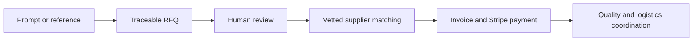

# Business Requirement Document (BRD) — Atelix
### The "Why": what the business wants

**Audience:** Product Owner, Client/Founder, Business Analyst, CTO/VP Engineering (context-setting section).

**Status:** Draft, derived strictly from the source documents below. No goal, KPI, risk, or stakeholder is invented — anywhere this document would normally state a number or a target that the source docs don't give, it says **"Not specified in source docs"** instead of guessing.

**Source documents (source of truth):**
- `PRODUCT.md`, `DESIGN.md`, `AGENTS.md`, `CLAUDE.md` — the shipped baseline product contract (repo root).
- `docs/AI_NATIVE_HUMAN_LOOP_PLATFORM_PLAN.md`, cited here as **`PLAN.md`** — the decision-complete specification for the next feature wave (AI-native sourcing control plane + Visual QC).

---

## 1. Executive summary

Atelix is a **broker-led fashion sourcing workspace** for apparel, fabrics, trims, labels, accessories, and OEM/cut-and-sew production. A buyer describes what they need — as a prompt, image, or technical reference — and Atelix turns that into a **traceable RFQ**. From there, humans (Atelix Operations) do the accountable work: approving suppliers, negotiating and publishing quotes, verifying production quality, and authorizing shipment. AI's job is to **prepare that work**, never to replace the human decision. (`PRODUCT.md` §Purpose; `PLAN.md` §1)

> **Client-language framing:** "I need a system where a buyer just describes the clothing/product they want, and my team — not an AI — decides which factory to approach, what the price is, whether the sample passes quality, and when it ships. The AI should do the busywork: drafting emails, comparing quotes, and spotting defects in photos — but every consequential decision needs a name and a timestamp behind it."

The end-to-end path, stated consistently across every source document:

(`CLAUDE.md`; `PRODUCT.md` §Purpose; `DESIGN.md` §Rules; `AGENTS.md`)

`PLAN.md` (§1) extends this into the fuller **target journey**, without replacing any step above:

```mermaid
flowchart LR
    A[Buyer brief] --> B[Reviewed RFQ]
    B --> C[Eligible supplier<br/>recommendations]
    C --> D[Ops-approved<br/>outreach]
    D --> E[Supplier-confirmed<br/>terms]
    E --> F[Ops-approved<br/>quotes]
    F --> G[Buyer selection]
    G --> H[Sample and<br/>payment gates]
    H --> I[Production evidence]
    I --> J[AI visual-risk<br/>triage]
    J --> K[Ops QC approval]
    K --> L[Shipment and delivery]
```

The primary product promise (`PLAN.md` §1):
1. The buyer tells Atelix what they need.
2. AI prepares the operational work.
3. Humans authorize supplier, commercial, quality, and logistics decisions.
4. Buyer and administrator monitor the same authoritative progress in real time.

## 2. Business goals & KPIs

`PLAN.md` §24 states three metric families that the business will track. **Not specified in source docs:** numeric targets for any of them except one explicit target of zero. This document does not invent thresholds the source docs don't give.

| Goal area | What is tracked (verbatim intent) | Stated target |
|---|---|---|
| **Speed of the sourcing pipeline** | RFQ submission-to-review time; review-to-first-approved-outreach time; supplier response cycle time; quote preparation and approval time; buyer quote-selection time; production update SLA adherence; exception response time; QC review time; time from approved QC to shipment | Not specified in source docs |
| **Trust and quality of the AI layer** | Unsupported buyer-visible claim count; supplier-release reversals; quote correction/withdrawal rate; QC finding acceptance/dismissal/amendment rate; high-risk visual false-negative rate; missing-evidence recapture rate; notification duplicate/failure rate | **Unsupported buyer-visible claim count: target zero** — all others: not specified |
| **Technical health / cost** | PostgREST calls per surface load and workflow action; queue depth and oldest pending age; worker attempts and dead-letter rate; media-processing time; model latency/tokens/cost/failure rate; realtime reconnect/refresh frequency | Not specified in source docs |

The business rule underneath every KPI (`PLAN.md` §26, verbatim):

> "The platform is AI-native when agents continuously prepare and clarify work, not when they silently make irreversible decisions... The system earns trust by making those decisions faster, more observable, and more evidence-backed."

## 3. Stakeholder list

| Stakeholder | Stated role | Source |
|---|---|---|
| **Buyers** | Create and follow their own sourcing cases, attachments, invoices, and payment history; submit/revise RFQs; select quotes; pay invoices; approve/decline samples; message Ops | `PRODUCT.md` §Users; `PLAN.md` §3.1 |
| **Atelix Operations (admins)** | Review access requests, supplier submissions, RFQs, matches, orders, invoices; approve suppliers; prepare outreach; publish quotes; review QC; advance fulfillment | `PRODUCT.md` §Users; `PLAN.md` §3.2 |
| **Suppliers** | Submit capabilities for private review; no public directory; supplier-confirmed terms are recorded by Ops, not self-served | `PRODUCT.md` §Users; `PLAN.md` §2.2 |
| **Owner of `PLAN.md`** | Head of Engineering (document owner); audience listed as Product, Operations, Engineering, Security, and QA | `PLAN.md` header |
| **Engineering organization (delivery)** | SOL (orchestrator/Head of Engineering), Terra (technical lead), Luna A/B (engineers) | `PLAN.md` §21 |

**Not specified in source docs:** a named Product Owner, Business Analyst, or external Client distinct from the roles above — the source documents describe product/engineering roles, not a formal RACI beyond `PLAN.md` §21's engineering topology.

## 4. In-scope

### 4.1 Baseline (already shipped, per `PRODUCT.md`/`DESIGN.md`/`AGENTS.md`/`CLAUDE.md`)
- Four signed-in buyer surfaces: **Home, Requests, Messages, Invoices**. (`PRODUCT.md`)
- Intools operator shell, nine sections: **Analytics, Invoices, Orders, Requests, Sign-up requests, Suppliers, Knowledge, Messages, Audit history**. (`PRODUCT.md`)
- Prompt/reference-based RFQ intake, human review, vetted matching, Stripe-hosted invoicing, quality/logistics coordination. (`PRODUCT.md` §Purpose)
- Access-request-gated sign-up, password or magic-link/OTP sign-in. (`PRODUCT.md` §Workspace flow contract)

### 4.2 This wave (`PLAN.md`, extends the baseline — does not replace it)
1. Supplier-outreach drafting (Master settings + Request-drawer modal) — `PLAN.md` §5.
2. Quote approval atomicity (one transactional publish RPC) — `PLAN.md` §6.
3. Production monitoring extension of the existing RFQ Timeline/Orders — `PLAN.md` §7.
4. Visual QC: AI triage + mandatory human review — `PLAN.md` §8–§12.
5. Realtime activity stream + notification policy — `PLAN.md` §13, §15.7, §16.
6. Underlying agent/authority governance and orchestration layers — `PLAN.md` §2–§3, §14.

A tenth Intools section, **Master settings** (`/intools/settings`), is added — explicitly permitted because it is an explicitly requested operational surface, an exception to the "no new sections" rule below. (`PLAN.md` §5.1)

## 5. Out of scope (explicitly retired or excluded)

- **Public catalogue, seller storefront, cart, wishlist, or self-serve supplier directory** — Atelix is not any of these, in either the baseline or the new wave. (`PRODUCT.md` §Purpose; `PLAN.md` §1)
- **Standalone Products workspace** — retired; order-item snapshots and history live inside the owning RFQ and its invoice. `/dashboard/products` redirects to Requests. (`PRODUCT.md`; `CLAUDE.md`)
- **Retired product catalogue's Algolia index** — not reintroduced. (`PRODUCT.md`; `CLAUDE.md`)
- **A separate "RFQ review" surface or a separate AI control center** — Requests remains the single RFQ queue; the new plan explicitly does not add a separate AI control center. (`PRODUCT.md`; `PLAN.md` §1)
- **New page sections, subsections, promotional strips, or content blocks not explicitly requested** — one narrow exception is Master settings (§4.2 above). (`AGENTS.md`)
- **AI authority beyond triage/drafting/normalizing/summarizing** — AI is explicitly barred from approving suppliers, publishing quotes, settling payment, approving QC, or unlocking shipment. (`PLAN.md` §2.1, §23)
- **A trained/custom QC detector** — not to be built "until a specific recurring defect has consistent human-reviewed positive and negative examples and a held-out evaluation set," and even then it "remains triage-only until a separately approved authority change." (`PLAN.md` §20)
- **Non-English outreach templates in v1.** (`PLAN.md` §5.4)
- **Multi-currency quotes in v1 (USD only).** (`PLAN.md` §6)

## 6. Risks & assumptions

### 6.1 Risks named in `PLAN.md`

| Risk | Why it matters | Mitigation stated in source |
|---|---|---|
| A model output could be mistaken for authoritative truth | Breaks the "broker-led" promise and buyer trust | Truth/authority layering (§2.2) — AI output is always draft/recommendation/normalized/observation/request/summary, never truth |
| AI visual QC could be read as a pass/fail | Buyers or Ops could ship a defective order on AI say-so | QC is triage-only; forbidden output fields include `pass`, `fail`, `approved`, `shipment_ready`; absence of findings never implies approval (§2.3, §9, §10) |
| Unbounded/uncontrolled PostgREST calls under new automation (QC workers, notifications, realtime) | Repeats a known prior incident pattern of database overload from per-record loops (see `PRODUCT.md`/`AGENTS.md` load-safety rule, and this plan's own §17) | Database claim cap 2, current Vercel worker claim 1/invocation, bulk RPCs, cursor pagination, idempotency keys, capped concurrency, backoff, dead-letter state |
| Sending private QC evidence (buyer identity, supplier contacts, routing rationale, full videos) to a third-party model provider | Privacy/data-leak risk | Explicit "never send" list to OpenRouter; zero-data-retention (`zdr`) requirement; if no compatible privacy route exists, fail closed to `analysis_failed` rather than relax constraints (§11.2) |
| No structured labeled QC dataset exists yet | Model quality is unproven | Launch in internal shadow mode with mandatory Ops review of every run before any buyer-visible rollout (§20, §22 Wave 7) |
| Partial/interrupted writes (e.g., the current 3-call quote path) can leave inconsistent state | Data integrity / operator confusion | Move to one atomic transactional RPC (§6) |
| Rollout could strand in-flight records if disabled | Business continuity | Feature flags disable entry points only; rollback never deletes/rewrites data; existing reads keep working with every flag off (§25) |
| Vercel Hobby terminates long CPU work | A full video analysis could time out before findings are ready | Split work into durable stages, claim one inspection per invocation, checkpoint before 240 seconds, retry at most three times, then expose an explicit human-review fallback; AI remains non-authoritative |

### 6.2 Assumptions carried from the baseline contract

- Supabase remains authoritative for identity, roles, sourcing records, and permissions. (`PRODUCT.md`; `AGENTS.md`)
- Supabase Pro and Vercel are the only hosted infrastructure in this delivery. Supabase Pro owns Storage, queue state, leases, Vault-backed scheduling, and Realtime; the existing Vercel project hosts the app and a separate Vercel Hobby project hosts the resumable media worker. GCP, AWS, and Tencent are excluded. (`PLAN.md` §11.1)
- Stripe webhooks remain the only payment-settlement authority. (`PRODUCT.md`; `AGENTS.md`; `PLAN.md` §2.3)
- Every consequential change is attributable and auditable. (`PRODUCT.md`)
- Applied migrations are never rewritten; all schema change is additive. (`AGENTS.md`; `CLAUDE.md`; `PLAN.md` §2.4)
- WCAG 2.2 AA remains the accessibility bar for every new surface. (`PRODUCT.md`; `DESIGN.md`; reaffirmed `PLAN.md` §2.4, §23)

### 6.3 Known pre-existing defects (treated as risk to close before this wave ships)

`PLAN.md` §19 records a "repository bug-bash baseline" — real, already-identified bugs that must be fixed as part of Wave 1. Full list and expected-fix state: [`test-cases.md` §0](test-cases.md#0-pre-existing-defects-carried-from-the-bug-bash-baseline).

## 7. Truth and authority model (business guardrail, detailed in PRD 06)

Every business decision in this system sits on one of five layers, and only the bottom two layers may become "truth" without a human:

| Layer | Who/what produces it | Can AI create it? |
|---|---|---|
| Buyer-stated | The buyer | AI may extract/structure; buyer text remains the source |
| AI-extracted | A model, tied to evidence | Yes, as a non-authoritative observation |
| Supplier-confirmed | A supplier, recorded by Ops | No — AI may normalize only |
| Ops-verified | An accountable operator | No |
| Server-authoritative | A guarded backend workflow | No |

(`PLAN.md` §2.2 — full detail in [PRD 06](prd/06-personas-and-agent-authority.md))

## 8. Governance constraints that shape every business decision going forward

- One clear next action per working surface. (`PRODUCT.md`)
- Human approval before supplier outreach or commercial commitment. (`PRODUCT.md`)
- Hard eligibility checks before any model-written summary. (`PRODUCT.md`)
- Do not add a new page section, subsection, promotional strip, or content block unless explicitly requested. (`AGENTS.md`)
- Preserve current routes, guarded boundaries, and the existing dashboard/Intools visual contract. (`DESIGN.md`; `AGENTS.md`)
- Run lint, build, database/RLS, route, keyboard, responsive, and payment regression gates before any production action. (`AGENTS.md`)

## 9. Document map

| # | Feature | PRD | Primary `PLAN.md` sections |
|---|---|---|---|
| 1 | Supplier-outreach drafting | [prd/01](prd/01-supplier-outreach-drafting.md) | §5 |
| 2 | Quote approval atomicity | [prd/02](prd/02-quote-approval-atomicity.md) | §6 |
| 3 | Production monitoring | [prd/03](prd/03-production-monitoring.md) | §7 |
| 4 | Visual QC — triage and review | [prd/04](prd/04-visual-qc-triage-and-review.md) | §8–§12 |
| 5 | Realtime activity and notifications | [prd/05](prd/05-realtime-activity-and-notifications.md) | §13, §15.7, §16 |
| 6 | Personas and agent authority | [prd/06](prd/06-personas-and-agent-authority.md) | §2.2, §3, §14 |

Technical design and build detail (SDD + TSD): [`TRD.md`](TRD.md). Diagrams: [`data-flows.md`](data-flows.md). Test cases: [`test-cases.md`](test-cases.md). Reading order for each audience: [`README.md`](README.md).
