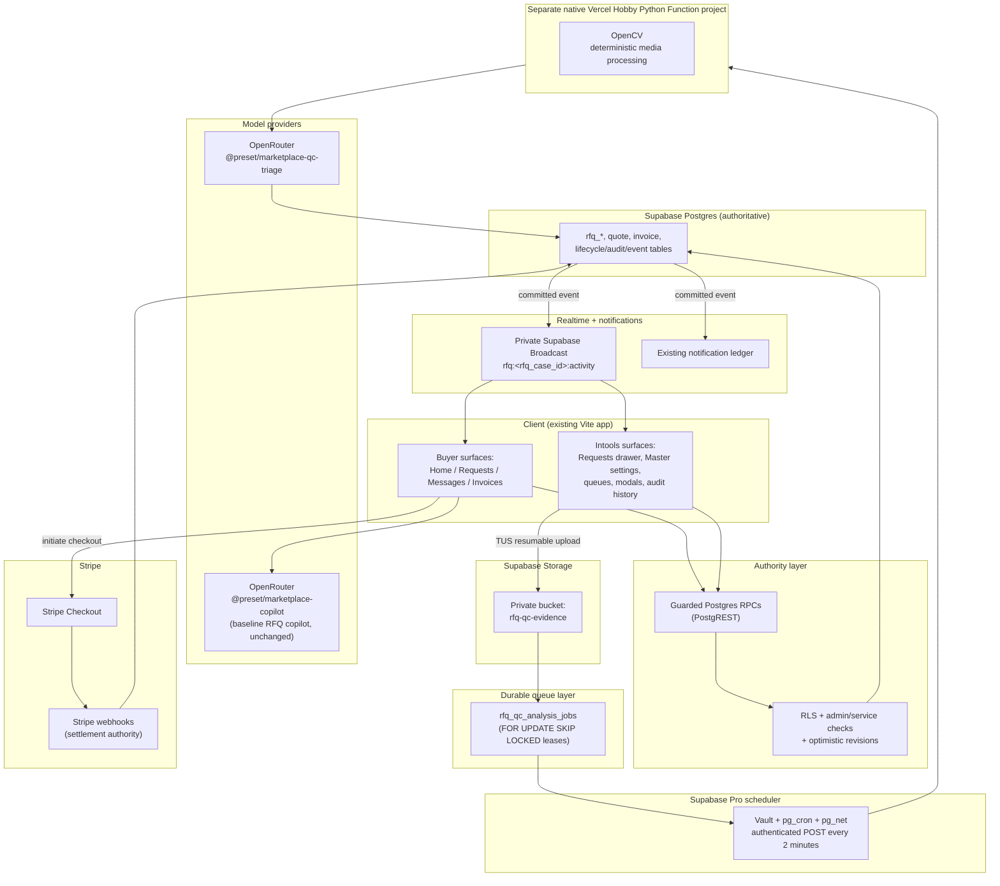
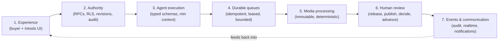
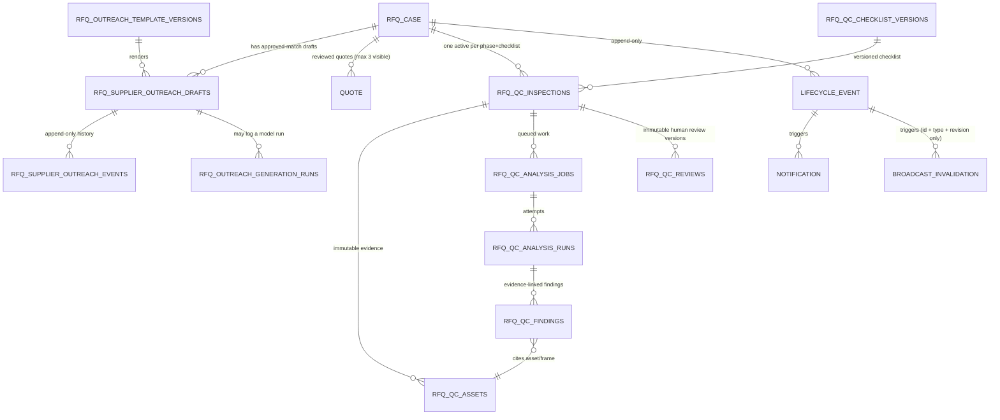

# Technical Requirements Document (TRD) — Atelix AI-Native Human-Loop Platform and Visual QC
### The "How": Software Design Document (SDD) + Technical Specification Document (TSD)

**Audience:** Tech Lead, Architect, Senior Devs (SDD, Part I) and Developers, QA, DevOps (TSD, Part II) — written so a VP of Engineering can review it end to end, and so a VP of Product can follow Part I's diagrams without needing the RPC-level detail in Part II.

**Status:** Draft, derived strictly from `docs/AI_NATIVE_HUMAN_LOOP_PLATFORM_PLAN.md` ("PLAN.md") and the baseline contract docs (`PRODUCT.md`, `DESIGN.md`, `AGENTS.md`, `CLAUDE.md`). Every RPC name, table, limit, and endpoint is copied verbatim from `PLAN.md`. Where the source material only states "final tech stack"-style facts partially (e.g., no database version, no framework name beyond what's cited), this document says **"Not specified in source docs"** rather than filling the gap with an assumption.

---

# Part I — Software Design Document (SDD)

## I.1 High-level architecture



Sources: `PLAN.md` §11.1 (stack), §14 (orchestration layers), §15.7 (realtime), `PRODUCT.md` (OpenRouter copilot preset, Stripe).

### I.1.1 Why this shape (for a Product-side reader)

- The **Client** never talks to the database or to any model provider directly except through **guarded RPCs** — this is what makes "AI drafts, humans decide" enforceable in code, not just in policy.
- **Storage** is private and evidence flows into it before any AI ever sees it — QC media never touches the browser-to-model path directly.
- **Realtime** only ever carries an "something changed, go re-fetch" signal — never the changed data itself — which is why a compromised or intercepted realtime message can't leak commercial or supplier facts (`PLAN.md` §15.7).
- **Stripe webhooks**, not the browser, are the only thing allowed to mark an invoice paid (`PLAN.md` §2.3).

### I.1.2 Orchestration layers (system-level enforcement mechanism)


(`PLAN.md` §14 — see [PRD 06 §6](prd/06-personas-and-agent-authority.md#6-orchestration-layers-system-level-enforcement-mechanism) for what belongs in each layer.)

## I.2 Module breakdown

| Module | Responsibility | Owns (per `PLAN.md` §21) |
|---|---|---|
| **Outreach / rollout** | Template governance and audited dependency-aware feature flags (Master settings) + per-match draft/copy/contact | Backend: RPCs, tables, audit triggers (Luna A). Frontend: Master settings UI, outreach modal (Luna B) |
| **Quote** | Atomic reviewed-quote publication | Backend: one RPC replacing 3-call path (Luna A) |
| **Production** | RFQ Timeline/Orders extension, lifecycle substates | Backend: aggregate RPC extension (Luna A). Frontend: Intools production controls, buyer progress presentation (Luna B) |
| **QC — upload & pipeline** | Reservation → TUS upload → finalize → queue → worker (OpenCV) → OpenRouter analysis | Backend: worker (Luna A per vision-engine wave). Frontend: fixtures/model-quality tooling (Luna B per vision-engine wave) |
| **QC — review** | Ops decision, immutable review versions, shipment guard | Backend: review RPC (Luna A). Frontend: Ops review controls, buyer-safe evidence reads (Luna B) |
| **Realtime & notifications** | Broadcast invalidation, notification policy, idempotent delivery | Backend: event triggers (Luna A). Frontend: realtime invalidation client logic, accessibility/UI tests (Luna B) |

Shared hotspots with one temporary owner at a time: `src/dashboard.tsx`, `src/intools.tsx`, `src/supabase.ts`. (`PLAN.md` §21.4)

## I.3 Conceptual data design (entity relationships)



Field-level contracts for every table above are in [I.5 Data models](#i5-data-models-conceptual). This diagram exists so a reviewer can see, at a glance, that:
- Nothing points backward into an activated template or a published review (they're immutable).
- Findings can only exist attached to a run, which can only exist attached to a job, which can only exist attached to an inspection — there is no path for a "loose" finding.

## I.4 API interface overview (by layer, not by field — see TSD for signatures)

| Interface group | Direction | Purpose |
|---|---|---|
| Outreach RPCs | Intools → Postgres | Template lifecycle + per-match draft lifecycle |
| Quote RPC | Intools → Postgres | One atomic reviewed-quote publish |
| QC upload RPCs + direct TUS | Intools ↔ Postgres, Intools → Storage | Reserve → upload → finalize → queue |
| QC worker trigger | Supabase Pro Vault/`pg_cron`/`pg_net` → Vercel Hobby `POST /run` | One authenticated trigger every two minutes; no media/user payload |
| QC worker RPCs | Vercel Hobby Python Function (service role) → Postgres | Claim one → context → checkpoint or complete, bulk and bounded |
| QC review RPC | Intools → Postgres | Publish immutable human decision |
| Aggregate read RPCs | Buyer/Intools → Postgres | One bounded response per surface load |
| Realtime channel | Postgres → Buyer/Intools | Invalidation-only broadcast |
| OpenRouter (QC) | Vercel Hobby worker → OpenRouter | Structured, evidence-linked visual-risk analysis |
| Stripe Checkout/webhook | Buyer → Stripe → Postgres | Server-computed invoice, webhook-settled payment |

Full RPC signatures: [II.2 API specification](#ii2-api-specification).

## I.5 Data models (conceptual)

### Outreach (`PLAN.md` §5.4)

**`rfq_outreach_template_versions`** — `id`, `locale` (`en` in v1), `version` (monotonic int), `subject_template` (1–240 chars), `body_template` (1–12,000 chars), `status` (`draft`/`active`/`retired`), `created_by`, `activated_by`, timestamps. Activated versions immutable; editing creates a new version; only one active English version.

**`rfq_supplier_outreach_drafts`** — `rfq_case_id`, `match_id`, `template_version_id`, `subject`, `body`, `resolved_fields` (allowlisted substitution snapshot), `status` (`draft`/`copied`/`contacted`/`superseded`), `revision` (optimistic concurrency int), `created_by`, `updated_by`. Only one current non-superseded draft per case+match.

**`rfq_supplier_outreach_events`** — append-only: creation, edit, reset, copy, contact, supersession. A copy event records which part was copied, never claims delivery.

**`rfq_outreach_generation_runs`** — model/preset, prompt hash, template version, token/cost/latency metadata, output status, failure reason. Model output never required for deterministic rendering.

### QC (`PLAN.md` §12)

**`rfq_qc_checklist_versions`** — immutable category/stage checklist versions, required views, criteria, exclusions, capture instructions, creator, activation state.

**`rfq_qc_inspections`** — RFQ, lifecycle phase, order, category, checklist version, substate, current revision, current analysis run, current published review, timestamps. Only one active inspection per RFQ+phase+checklist version.

**`rfq_qc_assets`** — immutable object path, original name, MIME type, size, checksum, capture/source metadata, processing state, uploader, buyer-visibility state.

**`rfq_qc_analysis_jobs`** — job state, durable worker stage (`probe`, `extract_segments`, `consolidate`, `analyze`, `validate_complete`), deterministic cursor/checkpoint, derived-artifact manifest, lease, attempt count, next attempt, asset-set hash, analyzer version, checklist version, bounded last error, timestamps. Idempotency key = `inspection_id + asset_set_hash + checklist_version + analyzer_version`.

**`rfq_qc_analysis_runs`** — run status, engine versions, model/provider, prompt hash, strict schema version, input/output tokens, provider-reported cost, latency, attempt count, preprocessing report, failure reason.

**`rfq_qc_findings`** — validated structured findings; every asset/frame/timestamp/checklist reference must belong to the owning inspection/run.

**`rfq_qc_reviews`** — immutable human review versions: decision, rationale, accepted/dismissed/amended finding IDs, buyer-visible summary/assets, reviewer, time.

## I.6 Security considerations

- **Authentication + role checks + RFQ ownership + private Storage access + RLS + guarded server mutations at every boundary.** (`PLAN.md` §2.4)
- **Credential isolation:** never place service-role, Stripe secret, webhook, or OpenRouter credentials in Vite code or `VITE_*` variables. (`AGENTS.md`)
- **Service-role-only worker RPCs**: `qc_claim_analysis_jobs`, `qc_get_analysis_context`, `qc_complete_analysis_jobs` are service-role only — never callable from the browser. (`PLAN.md` §15.4)
- **Admin-only surfaces**: every outreach, quote-publish, and QC-review RPC is admin-only. (`PLAN.md` §15.1, §15.2, §15.5)
- **Data minimization to third-party model provider**: only derived analysis images and checklist/reference context reach OpenRouter — never original full videos, buyer identity/contact, supplier private contacts, routing rationale, non-visual-inspection commercial terms, or long-lived signed URLs. Zero-data-retention (`zdr: true`, `data_collection: "deny"`) is a hard requirement; if no compatible route exists, the run fails closed to `analysis_failed` rather than relaxing the constraint. (`PLAN.md` §11.2)
- **Realtime payload minimization**: broadcast carries only `event_id`, `event_type`, `revision` — never findings, supplier data, commercial terms, storage paths, signed URLs, or evidence bytes. (`PLAN.md` §15.7)
- **Immutability as a security property**: activated templates, published reviews, and applied migrations are never overwritten — only superseded/versioned — which makes tampering or silent correction structurally visible in the audit trail. (`PLAN.md` §5.4, §7.2, §12.7; `AGENTS.md`)
- **Fail-closed guard on shipment**: the guarded shipment RPC fails closed without a current approved QC review. (`PLAN.md` §18)

## I.7 Data flow diagrams

See [`data-flows.md`](data-flows.md) for the full set (end-to-end flowchart, plus one sequence diagram per feature).

---

# Part II — Technical Specification Document (TSD)

## II.1 Final tech stack (as stated in source docs)

| Layer | Technology | Source |
|---|---|---|
| Frontend | Existing Vite application (React-style routes/components implied by `src/dashboard.tsx`, `src/intools.tsx` filenames) | `CLAUDE.md`; `PLAN.md` §21.4 |
| Database | Supabase Postgres | `PLAN.md` §11.1 |
| File storage | Supabase Storage, private bucket `rfq-qc-evidence`, TUS resumable upload protocol | `PLAN.md` §11.1, §11.3 |
| Server API surface | Guarded Postgres RPCs via PostgREST (`intools_*`, `workspace_*`, `qc_*` naming) | `PLAN.md` §15 |
| Auth/orchestration seam (lightweight) | Supabase Edge Functions (authorization only — not media processing; hosted limit 256 MB memory / 2s CPU) | `PLAN.md` §11.1 |
| Durable scheduler | Supabase Pro Vault + `pg_cron` + `pg_net`; authenticated trigger every two minutes | `PLAN.md` §11.1 |
| Async media processing | Separate native Vercel Hobby Python Function project rooted at `workers/qc`; Python 3.12 runtime; 300s/2 GB/1-vCPU platform ceiling; 240s application budget | `PLAN.md` §11.1 |
| Media tooling | OpenCV | `PLAN.md` §11.1, §11.3 |
| AI — visual QC | OpenRouter, preset `@preset/marketplace-qc-triage`, initial model `google/gemini-3.5-flash-lite` | `PLAN.md` §11.2 |
| AI — RFQ copilot (baseline, unchanged by this plan) | OpenRouter, preset `@preset/marketplace-copilot` | `PRODUCT.md` §Workspace flow contract |
| Realtime | Supabase Broadcast (private channels) | `PLAN.md` §15.7 |
| Payments | Stripe Checkout + webhooks | `PRODUCT.md`; `AGENTS.md`; `PLAN.md` §2.3 |
| Search (retired, do not reintroduce) | Algolia | `PRODUCT.md`; `CLAUDE.md` |

**Not specified in source docs:** specific Postgres version, CI/CD tooling, caching layer (e.g., no Redis is mentioned anywhere in the source set), specific frontend framework version, or Vercel worker region.

## II.2 API specification

### II.2.1 Outreach RPCs (`PLAN.md` §15.1)

| RPC | Params | Behavior |
|---|---|---|
| `intools_get_rfq_outreach_settings()` | — | Returns active English template, version, placeholder dictionary, example render. Admin-only. |
| `intools_save_rfq_outreach_template` | `p_subject, p_body, p_expected_version` | Validates length + placeholder allowlist; creates a new **draft** version; never updates an activated version. |
| `intools_activate_rfq_outreach_template` | `p_template_version_id` | Locks locale, retires previous active version, activates selected version, appends audit event — one transaction. |
| `intools_prepare_rfq_outreach_draft` | `p_case_id, p_match_id` | Revalidates RFQ submission + match approval + supplier eligibility; resolves active template from authoritative records; returns one saved draft. |
| `intools_update_rfq_outreach_draft` | `p_draft_id, p_subject, p_body, p_expected_revision` | Admin-only optimistic update; stale revision → conflict, no overwrite. |
| `intools_reset_rfq_outreach_draft` | `p_draft_id, p_expected_revision` | Revalidates eligibility and renders the latest active template from allowlisted authoritative fields; optimistic update + supersession event. |
| `intools_record_rfq_outreach_copy` | `p_draft_id, p_part` (`subject`/`body`/`all`) | Records copy event; returns unchanged draft; does **not** mark contacted. |
| `intools_mark_rfq_supplier_contacted` | `p_draft_id, p_note` | Revalidates match/supplier/RFQ state; records external contact event; updates outreach status; advances RFQ to `awaiting_supplier` when appropriate. |
| `intools_record_rfq_supplier_response` | `p_draft_id, p_note, p_evidence_reference` | Requires a contacted draft and evidence reference; appends supplier-response event; advances RFQ to `supplier_replied`; never creates/publishes quote terms. |

### II.2.2 Quote RPC (`PLAN.md` §15.2)

| RPC | Params | Behavior |
|---|---|---|
| `intools_publish_rfq_quote_reviewed` | `p_quote_id, p_payload, p_expected_revision` | One transaction: upsert draft fields → validate supplier evidence + total → enforce quote cap (3) → publish → lifecycle/audit/notification records. |

### II.2.3 QC upload RPCs (`PLAN.md` §15.3)

| RPC | Params | Behavior |
|---|---|---|
| `intools_reserve_qc_upload` | `p_case_id, p_inspection_id, p_asset_id, p_filename, p_content_type, p_byte_size` | Validates admin, inspection, file type, size, active-reservation cap; returns generated immutable object path + short-lived upload authorization. |
| *(direct TUS upload)* | — | Browser uploads directly to Supabase Storage hostname; progress + resume; never proxies video bytes through Vite/Vercel/Edge Function. |
| `intools_finalize_qc_upload` | `p_asset_id, p_storage_path, p_sha256` | Validates reservation + stored object metadata; consumes reservation; inserts asset; idempotently queues analysis. |

### II.2.4 QC worker RPCs (`PLAN.md` §15.4`) — service-role only

| RPC | Params | Behavior |
|---|---|---|
| `qc_claim_analysis_jobs` | `p_limit` (database cap **2**; Vercel worker always passes **1**) | `FOR UPDATE SKIP LOCKED` claim, sets lease, returns job IDs only. |
| `qc_get_analysis_context` | `p_job_ids` | One bulk call: checklist, approved RFQ spec, permitted reference assets, source asset metadata, job versions. |
| `qc_checkpoint_analysis_jobs` | `p_results` | Validates active leases; persists stage, cursor, derived-artifact manifest, timing and bounded error metadata; renews or releases work without creating findings or changing QC authority. |
| `qc_complete_analysis_jobs` | `p_results` | One bulk call: validates run/result schemas, asset IDs, timestamps, checklist refs, job leases before commit. |

### II.2.5 QC review RPC (`PLAN.md` §15.5)

| RPC | Params | Behavior |
|---|---|---|
| `intools_review_qc_inspection` | `p_inspection_id, p_analysis_run_id, p_decision, p_note, p_buyer_visible_asset_ids, p_expected_revision, p_finding_dispositions, p_buyer_visible_summary, p_expected_next_update` | Admin-only. Requires one disposition per run finding; snapshots checklist/assets; keeps private rationale separate from buyer-safe summary; requires follow-up time for non-approved decisions; creates the immutable review and unlocks shipment **only** for `approved`. |

### II.2.6 Aggregate read RPCs (`PLAN.md` §15.6)

| RPC | Returns |
|---|---|
| `workspace_get_rfq_production(p_case_id)` *(extended)* | Selected quote; lifecycle; phase invoices; authoritative order + fulfillment stage; granular event IDs/types/actors/notes/metadata/timestamps; latest published production update; current published QC review; buyer-visible QC asset metadata; next expected update; current exception summary |
| `intools_get_rfq_operations(p_case_id)` *(new)* | RFQ; approved/suggested match summaries; outreach state; quotes; lifecycle; order; production updates; QC inspection/review; next actions |

### II.2.7 Realtime channel (`PLAN.md` §15.7)

Topic: `rfq:<rfq_case_id>:activity`. Payload: `{ "event_id": "uuid", "event_type": "qc_review_published", "revision": 14 }`. Client rules: debounce; one aggregate request in flight; queue at most one trailing refresh; refresh once on reconnect; unsubscribe on route/case change; never poll.

### II.2.8 OpenRouter QC request (`PLAN.md` §11.2)

Preset `@preset/marketplace-qc-triage`, model `google/gemini-3.5-flash-lite`:

```json
{
  "provider": { "require_parameters": true, "zdr": true, "data_collection": "deny" },
  "response_format": {
    "type": "json_schema",
    "json_schema": { "name": "atelix_qc_visual_risk", "strict": true }
  }
}
```

Docs cited: image input (openrouter.ai/docs/guides/overview/multimodal/image-understanding), structured outputs (openrouter.ai/docs/guides/features/structured-outputs), provider selection (openrouter.ai/docs/guides/routing/provider-selection), ZDR (openrouter.ai/docs/guides/features/zdr).

## II.3 Data models — see [I.5](#i5-data-models-conceptual) for the shared conceptual schema; no additional field-level DDL is given in `PLAN.md` beyond what is reproduced there.

## II.4 Visual-risk finding schema (`PLAN.md` §9)

Allowlisted categories: `evidence_quality`, `reference_mismatch`, `construction_or_workmanship`, `surface_damage`, `contamination_or_foreign_matter`, `color_or_finish_variation`, `measurement_evidence`, `label_or_packaging`, `seal_or_leakage`, `quantity_or_coverage`, `process_or_safety_observation`, `unknown`.

```json
{
  "category": "construction_or_workmanship",
  "severity": "medium",
  "confidence": 0.82,
  "asset_id": "uuid",
  "frame_id": "frame-0042",
  "timestamp_ms": 42000,
  "contact_sheet_cell": 6,
  "bounding_box": { "x": 0.31, "y": 0.42, "width": 0.18, "height": 0.12 },
  "observation": "Visible seam waviness along the lower edge.",
  "requirement_reference": "checklist:apparel:seam-finish",
  "why_it_matters": "May indicate inconsistent stitch tension or handling.",
  "uncertainty": "Thread tension cannot be confirmed from the image alone.",
  "recommended_follow_up": "Request a close-up from the front and reverse under neutral lighting."
}
```

`severity` ∈ {`low`, `medium`, `high`, `unknown`}, controls review priority only. Forbidden output fields: `pass`, `fail`, `approved`, `shipment_ready`, inferred composition, inferred certification, or a claim the complete order conforms.

## II.5 QC media pipeline specification (`PLAN.md` §11.3)

- **Bucket:** `rfq-qc-evidence` (private).
- **Accepted MIME types:** `image/jpeg`, `image/png`, `image/webp`, `video/mp4`, `video/quicktime`, `video/webm`.
- **Limits:** ≤10 images/update; ≤1 video/update; ≤250 MB/video; ≤3 min/video; no-overwrite, generated immutable paths.
- **Finalize checks:** valid reservation; allowed filename/extension; declared MIME type; storage object size; well-formed SHA-256 declaration; unique storage path. Before any model request, the worker verifies downloaded bytes against that checksum, checks magic bytes, and requires a successful decoder plus image-dimension or video-duration/resolution probe.
- **Analysis copies:** ≤2048px long edge (stills); metadata stripped; original + derived checksums retained; originals never overwritten.
- **Video frame strategy:** decode/validate with OpenCV → deterministic time segments with persisted cursor → sample 1 fps baseline → add scene-change/low-motion candidates → measure blur/exposure/entropy/motion → persist private derived candidates → dedupe across segments → select ≤72 frames → produce ≤8 timestamped 3×3 contact sheets → retain frame/contact-sheet mapping for citations.
- An unusable/incomplete/blurred/dark/corrupt/duplicated/checklist-incomplete evidence set → `evidence_quality` risk, never a defect verdict.

## II.6 Testing strategy

Verification gates (`PLAN.md` §23 "Verification gates"):

```text
npm run lint
npm run build
npm run qa:dashboard-prompt
npm run qa:agent-rfq
npm run qa:rfq-attachments
npm run qa:rfq-ops-chat
npm run qa:notification-center
npm run qa:workspace-scroll
npm run qa:intools-supplier-bulk
npm run qa:intools-analytics
npm run qa:endpoint-contracts
+ new outreach contract suite
+ new production/QC database and RLS suite
+ new media-worker deterministic suite
+ new model-quality suite (kept separate from deterministic tests)
+ local and linked database lint
+ migration-history check
+ authenticated buyer and Intools browser tests
+ Stripe/payment regression
+ PostgREST call-volume review
+ sampled image/video run before larger processing
+ git diff --check
```

Evidence must be reported **separately** for: source/build, local database, linked database, authenticated browser, deployed application, Supabase Storage, OpenRouter, email provider, and Stripe. (`PLAN.md` §23; reaffirmed in `CLAUDE.md`: "Before handoff, separate evidence for lint/build, local database/RLS tests, local HTTP routes, browser/accessibility checks, Git state, migrations, and deployment. Never claim an untested layer.")

Model evaluation strategy (`PLAN.md` §20) — internal shadow mode:
1. Run visual analysis on real Ops-mediated evidence.
2. Require Ops review for every run.
3. Capture accepted, dismissed, amended, and missed findings.
4. Preserve category, checklist, prompt, analyzer, frame-selection, model versions.
5. Build held-out evaluation sets per category.

Tracked model metrics: recall on human-confirmed visible defects; false-negative rate for human-rated high-risk defects; false-positive rate; evidence/timestamp correctness; missing-view detection accuracy; unsupported-claim rate; Ops override/amendment rate; median review time saved; cost and latency per inspection; analysis-failure rate. (`PLAN.md` §20)

## II.7 Performance & security standards (PostgREST / workload safety)

(`PLAN.md` §17, extending the baseline rule already in force in `PRODUCT.md`/`AGENTS.md`)

- Never issue one database request per supplier, frame, finding, notification recipient, or timeline event.
- Quote entry and publication use one atomic RPC.
- Visible RFQ state uses one aggregate RPC per surface refresh.
- Activity history uses stable cursor pagination.
- The database claim contract remains capped at **two**, but the Vercel Hobby worker claims exactly **one** inspection per invocation and advances one durable stage.
- Each invocation uses one claim RPC, one context RPC, and one checkpoint or completion RPC.
- Supabase Pro issues one authenticated scheduler request every two minutes; leases make overlapping invocations safe.
- Stop starting work after 220 seconds and checkpoint/exit by 240 seconds.
- Maximum **three attempts** with exponential backoff and dead-letter state; expired leases reclaimable.
- Upload finalization and worker completion are idempotent.
- Realtime invalidation is bounded and never becomes polling.
- Queue depth, oldest-job age, attempts, analysis latency, provider failures, and cost per inspection are observable.

Security standards are covered in [I.6 Security considerations](#i6-security-considerations) — this document does not repeat them here to avoid drift between two copies of the same rule.

## II.8 Deployment plan

### II.8.1 Delivery waves (`PLAN.md` §22)

| Wave | Scope |
|---|---|
| 1 — Restore lifecycle integrity | Restore authoritative order data in the buyer production aggregate; correct production labels/stage derivation; wire sample-ready and production-stage actions in Intools; correct notification routes; replace the stale supplier-bulk QA fixture; resolve routing-function volatility warnings additively; add lifecycle DB/UI regression tests |
| 2 — Supplier outreach | Private template/draft/event/generation tables; guarded outreach RPCs; Master settings; approved-match outreach modal; copy and contact kept as separate audited actions |
| 3 — Quote atomicity | One atomic reviewed-quote publication RPC; attach supplier evidence + approval identity; replace sequential browser calls; preserve visibility/cap |
| 4 — Production and QC foundation | Production-update and QC contracts; private QC bucket + resumable upload; checklist versions + capture requirements; Ops review controls + buyer-safe evidence reads; shipment approval guard |
| 5 — Vision engine | Separate native Vercel Hobby OpenCV Python Function; Supabase Pro scheduler; resumable stage checkpoints; strict OpenRouter vision analysis; evidence-citation + privacy-routing validation; internal shadow mode |
| 6 — Realtime and notifications | Private RFQ activity invalidation; bounded aggregate refresh; production/QC notification mapping; canonical deep links + delivery idempotency |
| 7 — Hardening and controlled rollout | Complete RLS/DB/media/model/UI/payment/load/browser testing; one sampled image inspection + one short sampled video; review shadow findings with Ops; enable buyer-visible reviewed QC evidence only after the human workflow is reliable |

### II.8.2 Rollout flags (`PLAN.md` §25)

```text
outreach_templates_enabled
atomic_quote_publication_enabled
production_updates_enabled
qc_evidence_upload_enabled
qc_ai_shadow_enabled
qc_buyer_visibility_enabled
rfq_activity_realtime_enabled
```

Rollback disables new entry points while retaining all committed evidence, reviews, and events. Never deletes or rewrites data. Existing RFQ/quote/invoice/payment/message/lifecycle reads must keep working with every new capability disabled. (`PLAN.md` §25)

### II.8.3 Engineering orchestration during delivery (`PLAN.md` §21)

Max active topology: 1 SOL (Head of Engineering) + 1 Terra (technical lead) + 2 Luna engineers. SOL owns architecture decisions, sequencing, file ownership, acceptance/release gates, final go/no-go — and does not accept a subsystem until Terra review + required QA evidence are present. Terra owns state-machine/schema/RPC/RLS/Storage/audit/idempotency design, model schema + evidence-validation design, threat model, PostgREST/worker load review, and reviews every Luna handoff. Luna A owns bounded backend (migrations, RPCs, Storage policies, worker contracts, notification triggers, DB/contract tests); Luna B owns bounded frontend/workflow (Master settings, outreach modal, Intools production/QC controls, buyer progress presentation, realtime invalidation, accessibility/UI tests). Every handoff states objective, owned files, interfaces changed, authority/security invariants, migration dependencies, tests run, PostgREST-call analysis, provider/runtime evidence, known gaps, rollback behavior.

## II.9 Repository bug-bash baseline (must close before this wave is production-ready)

See [`test-cases.md` §0](test-cases.md#0-pre-existing-defects-carried-from-the-bug-bash-baseline) for the itemized list and traceable expected-fix state. Verification snapshot at time of writing (`PLAN.md` §19, 2026-09-04): TypeScript lint passed; production build passed; RFQ-agent contract suite 30 passed (offline, no paid calls); RFQ attachment/notification/Ops-chat/dashboard-prompt contracts passed; workspace scroll/loading contract 8 passed; country-routing QA passed; Intools analytics QA passed; endpoint contract passed with 83 RPCs and 7 browser functions; local/remote migration history aligned through `20260902111500`; linked database lint completed with warnings; Intools supplier bulk QA **failed** (stale fixture); local database lint **unavailable** (local Postgres unreachable); worktree clean before the plan document was created.

## II.10 Not specified in source docs

- Concrete Postgres column types/constraints beyond the field-level "stores X" descriptions given.
- Exact Vercel worker region and exact OpenCV thresholds for blur/exposure/entropy/motion.
- CI/CD pipeline tooling, container registry, or environment-promotion process.
