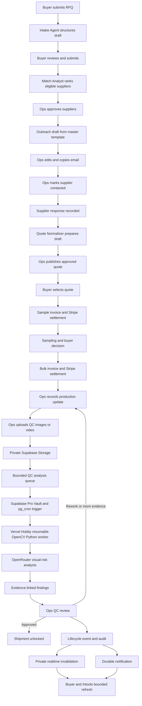
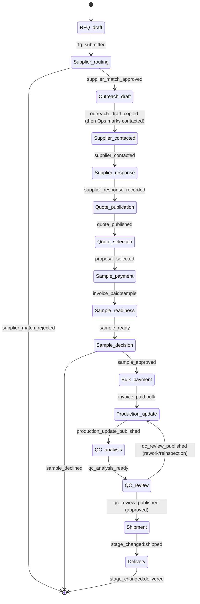
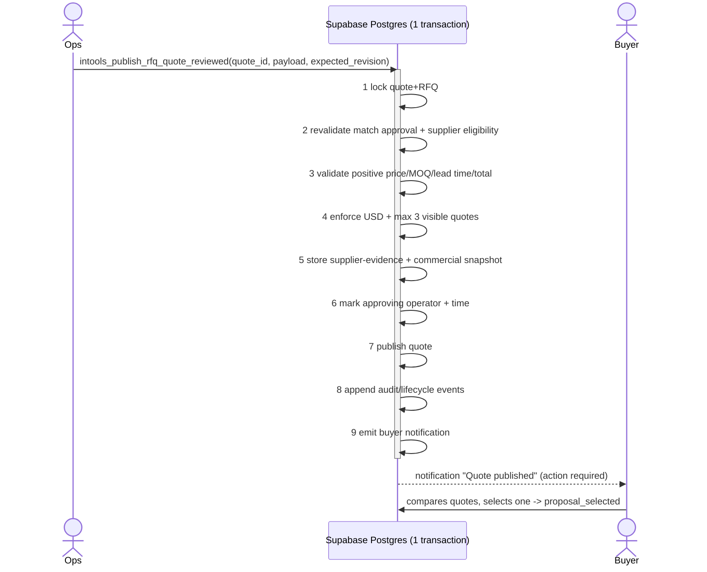
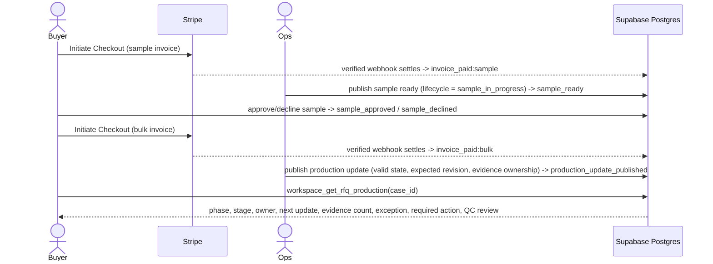
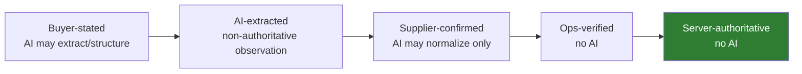

# Data Flow Diagrams — Atelix AI-Native Human-Loop Platform and Visual QC

**Source of truth:** `docs/AI_NATIVE_HUMAN_LOOP_PLATFORM_PLAN.md` ("PLAN.md"). The master flowchart in §1 is reproduced verbatim from `PLAN.md` §13; the per-feature sequence diagrams below are derived directly from the gate table (`PLAN.md` §4.2), the RPC descriptions (`PLAN.md` §15), and the realtime/notification contract (`PLAN.md` §15.7, §16) — no new steps, actors, or systems are introduced.

**Audience:** readable end to end by a VP of Product (follow the boxes/arrows and the plain-language notes) and a VP of Engineering (the RPC names and guard conditions are exact).

---

## 1. End-to-end master flow (verbatim, `PLAN.md` §13)



## 2. Gate table as a state machine (`PLAN.md` §4.2, redrawn as a diagram)



Every arrow above requires the **server guard** listed in `PLAN.md` §4.2 (e.g., "Latest QC review is approved" gates `Shipment`) — this diagram shows *reachability*, not permission; permission is enforced entirely server-side per [PRD 06](prd/06-personas-and-agent-authority.md).

## 3. Supplier outreach drafting — sequence (`PLAN.md` §5, §15.1)

```mermaid
sequenceDiagram
    actor Admin as Intools Admin
    actor Ops
    participant Settings as Master settings
    participant DB as Supabase Postgres
    actor Buyer

    Admin->>Settings: Author subject/body template
    Settings->>DB: intools_save_rfq_outreach_template(subject, body, expected_version)
    DB-->>Settings: new draft version
    Admin->>Settings: Activate version
    Settings->>DB: intools_activate_rfq_outreach_template(version_id)
    DB-->>Settings: previous retired, new active (1 transaction, audit event appended)

    Ops->>DB: intools_prepare_rfq_outreach_draft(case_id, match_id)
    DB-->>Ops: rendered subject/body (missing fields = "Not provided by buyer")
    Ops->>DB: intools_update_rfq_outreach_draft(draft_id, subject, body, expected_revision)
    Ops->>DB: intools_record_rfq_outreach_copy(draft_id, "all")
    Note over Ops,DB: Copy != sent. RFQ state unchanged.
    Ops->>Ops: Sends email OUTSIDE Atelix
    Ops->>DB: intools_mark_rfq_supplier_contacted(draft_id, note)
    DB-->>DB: event supplier_contacted; RFQ -> awaiting_supplier
    DB-->>Buyer: notification "Supplier outreach started" (case-level only)
```

## 4. Quote approval atomicity — sequence (`PLAN.md` §6, §15.2)



## 5. Production monitoring — sequence (`PLAN.md` §7, §15.6)



## 6. Visual QC — upload, analysis, and review (`PLAN.md` §8–§12, §15.3–15.5)

```mermaid
sequenceDiagram
    actor Ops
    participant DB as Supabase Postgres
    participant Storage as Supabase Storage (rfq-qc-evidence)
    participant Scheduler as Supabase Pro Vault + pg_cron + pg_net
    participant Worker as Vercel Hobby Python Function (OpenCV)
    participant OR as OpenRouter (@preset/marketplace-qc-triage)
    actor Buyer

    Ops->>DB: intools_reserve_qc_upload(case_id, inspection_id, asset_id, filename, content_type, byte_size)
    DB-->>Ops: immutable object path + short-lived upload authorization
    Ops->>Storage: Direct TUS resumable upload (never proxied through Vite/Vercel/Edge Function)
    Ops->>DB: intools_finalize_qc_upload(asset_id, storage_path, sha256)
    DB->>DB: validate reservation + object metadata -> insert asset -> idempotently queue analysis

    Scheduler->>Worker: POST /run every 2 minutes (authenticated; no media/user payload)
    loop bounded invocation (1 inspection, 1 durable stage, exit by 240s)
        Worker->>DB: qc_claim_analysis_jobs(limit=1)  [FOR UPDATE SKIP LOCKED, lease set]
        DB-->>Worker: job IDs
        Worker->>DB: qc_get_analysis_context(job_ids)  [1 bulk call]
        DB-->>Worker: checklist, approved spec, reference assets, source metadata
        alt stage incomplete or execution budget reached
            Worker->>DB: qc_checkpoint_analysis_jobs(results) [persist stage/cursor/artifact manifest; release or renew]
        else analysis ready to complete
            Worker->>Worker: OpenCV validation/extraction; <=72 frames; <=8 contact sheets
            Worker->>OR: derived images only (no full video, no buyer/supplier identity, no signed URLs); zdr=true, data_collection=deny, strict JSON schema
            OR-->>Worker: evidence-linked findings (allowlisted categories only, no pass/fail)
            Worker->>DB: qc_complete_analysis_jobs(results) [validates asset IDs/timestamps/checklist refs/lease]
        end
    end
    DB-->>Ops: qc_analysis_ready event; findings visible for review (not to buyer)

    Ops->>DB: intools_review_qc_inspection(inspection_id, analysis_run_id, decision, note, buyer_visible_asset_ids, expected_revision)
    DB->>DB: create immutable review version; update substate; append audit/lifecycle; emit notifications
    alt decision = approved
        DB-->>DB: unlock guarded shipment transition
        DB-->>Buyer: QC approved notification
    else rework_required / reinspection_required / insufficient_evidence
        DB-->>Buyer: notification only when published, with expected next update
        DB-->>Ops: back to Production update (re-loop)
    end
```

## 7. Realtime activity and notifications (`PLAN.md` §13, §15.7, §16)

```mermaid
sequenceDiagram
    participant DB as Supabase Postgres
    participant Broadcast as Private Broadcast<br/>rfq:&lt;case_id&gt;:activity
    participant Ledger as Notification ledger
    actor Client as Buyer / Intools client

    DB->>DB: transaction commits (e.g. qc_review_published)
    DB->>Broadcast: { event_id, event_type, revision }  (no findings/PII/paths/URLs)
    DB->>Ledger: durable notification record (idempotency key + canonical deep link)
    Broadcast-->>Client: invalidation signal
    Client->>Client: debounce; allow only 1 aggregate request in flight; queue <=1 trailing refresh
    Client->>DB: workspace_get_rfq_production(case_id) or intools_get_rfq_operations(case_id)
    DB-->>Client: authoritative aggregate
    Client->>Client: re-render (never poll; refresh once on reconnect)
    Ledger-->>Client: email only if row is "action required / exception / transactional milestone"
```

## 8. Truth/authority funnel (cross-cutting, `PLAN.md` §2.2 — see PRD 06)



Only box **E** is truth other systems, buyers, or Ops may rely on without further review.

## 9. Not specified in source docs

- No diagram in `PLAN.md` shows infrastructure networking (VPC, load balancer, CDN) — none of that is described in the source set, so none is drawn here.
- Timing/latency annotations on the diagrams above are not given numeric values in `PLAN.md` beyond the qualitative metrics listed in [`BRD.md` §2](BRD.md#2-business-goals--kpis).
